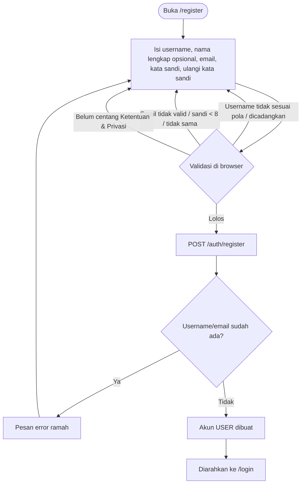

# Spesifikasi Alur Registrasi & Autentikasi Pasien (Klinik Terpadu)

## 1. Ikhtisar Arsitektur Autentikasi

- **Backend:** JWT HS256 (`JWT_SECRET_KEY` wajib diisi; backend di Vercel menolak start bila masih nilai bawaan), masa berlaku 24 jam, kata sandi bcrypt 12 rounds (`app/security/password.py`).
- **Frontend:** token disimpan di `localStorage` bila "Ingat saya" dicentang, selain itu di `sessionStorage` (hilang saat tab ditutup). Semua pembacaan token melewati `getToken()` (`apps/web/src/lib/api.ts`).
- **Tampilan:** kartu auth bergaya PRISMA (latar navy dengan glow, Plus Jakarta Sans, tombol gradien biru → cyan) lewat komponen `AuthShell` dan `PasswordInput` (`apps/web/src/components/auth/`).

## 2. Diagram Alur Registrasi Pasien (Activity Diagram)

## 3. Alur Pendaftaran Mandiri Pasien (*Registration Workflow*)

### 3.1. Jalur 1: Pendaftaran Pasien
Satu-satunya jalur pendaftaran publik. Hasilnya **selalu** akun `USER`. Aturan field:
- Username 3–30 karakter `[a-z0-9._]` (backend menerima 3–50); `admin`, `administrator`, `root`, `superuser`, `admin_rsukt`, `system` ditolak.
- Email sesuai pola backend `^[\w.-]+@[\w.-]+\.\w+$`.
- Kata sandi minimal 8 karakter, dengan pengukur kekuatan visual (bukan aturan keamanan).

### 3.2. Jalur 2: Pemberian Peran Admin
Tidak ada pendaftaran admin. Admin Riset mengubah peran lewat **Kelola Pengguna** (`PATCH /admin/users/{id}`). Admin Riset tidak bisa mengubah akunnya sendiri, dan Admin Riset aktif terakhir tidak bisa dicabut. Akun awal `admin` dan `periset` hanya dibuat di lokal atau bila `ADMIN_BOOTSTRAP_PASSWORD` diisi.

### 3.3. Pencegahan Duplikasi & Serangan Brute-Force
- Username dan email unik di tabel `users`.
- Login: maksimal 8 kegagalan / 5 menit per pasangan IP + identitas → `429`.
- Lupa sandi: maksimal 5 permintaan / 15 menit per IP.
- Pembatas berjalan per proses server (in-memory); pada banyak instance serverless batasnya tidak global. Ini keterbatasan yang tercatat.

## 4. Alur Autentikasi Pengguna (*Login Workflow*)

### 4.1. Fitur Utama Formulir Login
- Satu kolom "Username atau email" (pencarian tidak peka huruf besar/kecil).
- Tombol tampilkan/sembunyikan kata sandi.
- "Ingat saya" (default aktif).
- Tautan "Lupa kata sandi?" → kode pemulihan 6 digit, berlaku dalam jendela 15 menit, terikat pada hash kata sandi sehingga otomatis sekali pakai.
- Tombol "Pasang Aplikasi" muncul bila browser mengizinkan instalasi PWA; toggle tema terang/gelap di header.

## 5. Matriks Peran Pengguna (*Role-Based Redirect*)

| Peran | Setelah login | Ditolak di |
|---|---|---|
| `USER` | `/chat` | semua `/admin/*` |
| `ADMIN` | `/admin/dashboard` | `/chat/*`, halaman riset `/admin/*` |
| `RESEARCHER` | `/admin/dashboard` | `/chat/*` |

Sumber: `homePathForRole()` dan `canAccess()` di `apps/web/src/lib/roles.ts`, dicerminkan di server oleh `require_admin` / `require_researcher` dan blokir admin di `routes/chat.py`.

## 6. Standar Keamanan & Perlindungan Data Pribadi (UU PDP)

- Pesan error login generik agar tidak membocorkan keberadaan akun.
- Token tidak pernah diletakkan di URL.
- Proxy web tidak meneruskan cookie ke backend.
- HSTS aktif; halaman auth tidak bisa dibingkai situs lain (`frame-ancestors 'self'`).
