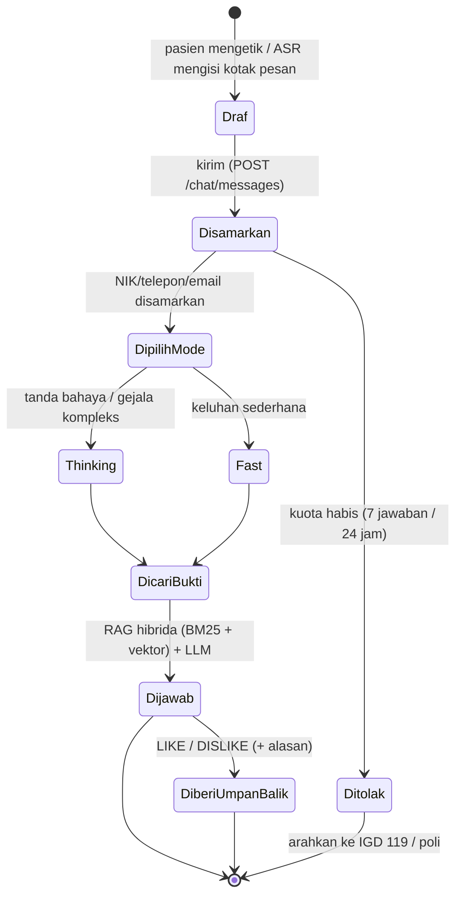

# Alur Kerja Konsultasi Klinis (Clinical Chat Workflow State Machine)

Padanan `LETTER_WORKFLOW.md` pada templat: di Klinik Terpadu, objek bisnis utama adalah **pesan konsultasi**, bukan surat.

## 1. Diagram State Machine Transisi Status Konsultasi

## 2. Aturan Transisi Eksplisit & Validasi Wewenang

| Transisi | Syarat | Pelaku |
|---|---|---|
| Draf → Disamarkan | Teks 1+ karakter; pengirim bukan `ADMIN`/`RESEARCHER` | Pasien / tamu |
| Disamarkan → Ditolak | Kuota harian habis | Sistem |
| DipilihMode → Thinking | `mode_router`: ada kata tanda bahaya, obat, relasi graf, atau ≥ 3 gejala | Sistem |
| DicariBukti → Dijawab | Bukti dari dokumen `APPROVED` saja | Sistem |
| Dijawab → DiberiUmpanBalik | Pesan milik sesi pasien itu sendiri | Pasien pemilik sesi |

## 3. Transisi Ilegal yang Ditolak Sistem

| Upaya | Respons |
|---|---|
| Admin mengirim pesan atau membuka sesi pasien | `403` |
| Pasien membuka sesi milik pasien lain | `404` (tidak membocorkan keberadaan sesi) |
| Mengirim melebihi kuota | Pesan penutup + arahan IGD/poli |
| Umpan balik dengan `feedback_type` selain LIKE/DISLIKE | `422` |

## 4. Mekanisme Keamanan Konkurensi & Konsultasi Suara/Kamera

- **Streaming:** `POST /chat/messages/stream` memakai SSE. Service worker sengaja tidak menyentuh rute `/api/*` dan `text/event-stream`, jadi streaming tidak terganggu cache.
- **Konsultasi suara & kamera (`/chat/suara`):**
  1. Pasien menyetujui layar persetujuan (kamera opsional).
  2. Mikrofon dianalisis di perangkat: VAD dengan ambang yang dikalibrasi dari derau, pitch/intonasi, jeda, latency respons, dan *tone up*.
  3. Segmen ucapan ditranskripsi Whisper di Web Worker (KV cache, continuous batching, auto-tuning model/batch).
  4. Kamera (bila aktif) dianalisis MediaPipe Face Landmarker: raut (Netral/Tersenyum/Tegang/Sedih/Terkejut/Cemas), kedipan per menit, gerak kepala.
  5. "Lanjutkan ke chat" hanya **mengisi** kotak pesan dengan transkrip dan, bila dicentang, catatan non-verbal. Pasien tetap yang menekan Kirim.
- Video dan audio tidak pernah dikirim ke server.

## 5. Jejak Rekam Audit (*Audit Trail*)

- `chat_messages` menyimpan `triage_department`, `safety_alert`, `citations`, `evidence_context`.
- `feedback_records` menyimpan reward per pesan (`reward_rate`, `adjusted_score`, `model_version`).
- Aksi admin/riset (training, ekspor, ubah peran) tercatat di `audit_logs`.
- Admin melihat umpan balik dengan isi chat disamarkan; laporan insight hanya berisi agregat.
