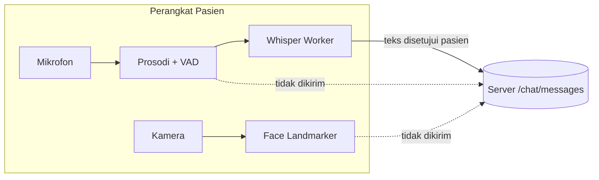

# 📊 Analisis Performa, Penyimpanan & Memori (Serverless, RAG, dan Model On-Device)

## 1. Klarifikasi Teknis: Ukuran Data Utama

| Aset | Ukuran / dimensi | Catatan |
|---|---|---|
| Dataset risiko jantung | ±20 MB, 158 ribu baris | Disampel reservoir (default 15–20 ribu baris) agar training muat di batas waktu serverless |
| Folder model backend | ±18 MB (`services/ai-api/models`) | joblib scikit-learn |
| Embedding RAG | 384 dimensi, ternormalisasi L2 | `rag/vector_store.py` |
| Whisper on-device | ±40–75 MB (tiny/base, q8 di WASM) | Diunduh sekali ke cache browser pasien |
| Face Landmarker | model float16 MediaPipe | Diunduh sekali dari Google Storage |

## 2. Visualisasi Perbandingan Arsitektur: On-Device vs Server

Memproses audio/video di server berarti mengunggah ±1–2 MB per menit per pasien dan butuh GPU. Dengan pemrosesan on-device, yang dikirim hanya beberapa ratus byte teks.

## 3. Matriks Simulasi Kebutuhan Storage & Memori (RAM)

| Komponen | Memori kerja | Waktu (uji lokal) |
|---|---|---|
| Pipeline insight (teks ±190 dokumen + 20 ribu baris jantung) | belum diukur | ±8–9 dtk di laptop pengembang |
| Fungsi Vercel | batas plan | `maxDuration` 60 dtk (`vercel.json`) |
| Worker ASR di browser | belum diukur; tergantung model & backend (WebGPU/WASM) | RTF diukur saat load; model turun ke tiny bila RTF > 0,9 |

## 4. Analisis Dampak Terhadap Server

### A. Beban Memori (RAM)
Artefak insight di-cache per instance (`_cache` di `patient_insights.py`). Instance baru tanpa artefak melatih versi ringan (2 putaran, 8 ribu baris) sekali saat dibutuhkan.

### B. Beban Pemroses (CPU)
Seluruh ML backend berbasis CPU (scikit-learn). Training berat (fine-tuning Whisper, SFT LLM) dialihkan ke Colab/GPU lewat ekspor.

### C. Efisiensi Jaringan & Database I/O
- CRUD real-time memakai polling 5 detik **hanya saat tab terlihat**, ditambah sinkron antar-tab tanpa jaringan (BroadcastChannel).
- Laporan insight dipoll tiap 15 detik.
- Aset statis ber-hash di-cache *cache-first* oleh service worker.

## 5. Kepatuhan Regulasi & Standar Privasi

Pemrosesan biometrik on-device menjalankan prinsip minimisasi data. Ekspor tidak memuat chat pasien. Lihat [DATA_CLASSIFICATION.md](DATA_CLASSIFICATION.md).

## 6. Kesimpulan

Arsitektur ini menjaga beban server tetap kecil (CPU, tanpa GPU, tanpa unggahan media), dengan biaya unduhan model satu kali di perangkat pasien. Risiko utamanya adalah perangkat lama yang lambat menjalankan Whisper. Ini ditangani dengan auto-tuning ke model tiny dan batch 1.
