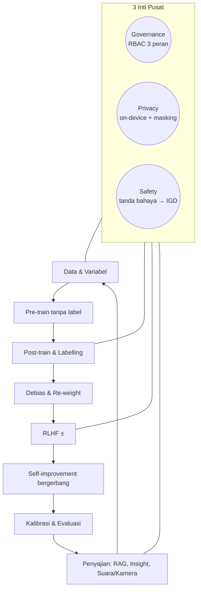

# Penerapan Metode, Algoritma & Standarisasi: Kerangka Diagram Lingkaran Klinik Terpadu

## 1. Visualisasi Paradigma Diagram Lingkaran

## 2. Pemetaan Komprehensif: Segmen Keliling & Inti Pusat

| Segmen | Implementasi | Berkas |
|---|---|---|
| Data & variabel | Penyamaran PII, ekstraksi variabel query (usia, durasi, suhu, tensi, negasi, intensitas, fitur mode router) | `ml/patient_insights.py` |
| Pre-train | TF-IDF (1–2 gram) → LSA (TruncatedSVD) → KMeans pola | `TextInsightModel.pretrain` |
| Post-train & labelling | Regresi logistik pada [TF-IDF ‖ laten], auto-tune C | `TextInsightModel.posttrain` |
| Debias | Reweighing Kamiran–Calders + penyeimbangan kelas; audit fairness jantung | `balanced_reweighing`, `train_cardio_track` |
| RLHF ± | Reward-weighted dari LIKE/DISLIKE + eksplorasi acak | `rlhf_weights` |
| Self-improvement | Hard-example mining + RLHF + auto-tune, diterima hanya bila val naik | `run_pipeline` |
| Kalibrasi & evaluasi | Temperature scaling, macro-F1, ECE, AUC, Brier | `calibrate`, `score_text_model` |
| Penyajian | RAG hibrida, prediksi + alasan, ASR & prosodi on-device | `rag/*`, `routes/insights.py`, `lib/voice`, `lib/vision` |
| Inti: Governance | `require_admin` / `require_researcher`, audit log | `security/auth.py` |
| Inti: Privacy | Mask PII, ekspor tanpa chat, media tidak dikirim | `safety.py`, `insights.py` |
| Inti: Safety | Mode Thinking untuk tanda bahaya, kuota, disclaimer | `agents/safety.py`, `mode_router.py` |

Metode graf (`rag/knowledge_graph.py`, `routes/graph_crud.py`) **tidak diubah** oleh pipeline Sprint 23.

## 3. Rincian Algoritma & Formula Matematika

### 3.1. Algoritma 1: RAG Hibrida dengan Reciprocal Rank Fusion
Skor gabungan dokumen *d* dari peringkat BM25 dan vektor: `RRF(d) = Σ_r 1 / (k + rank_r(d))`, dengan `k = 60`. Hanya dokumen `APPROVED` yang diindeks.

### 3.2. Algoritma 2: Reweighing Kamiran–Calders + Penyeimbangan Kelas
`w(g, y) = P(g)·P(y) / P(g, y)`. Grup *g* adalah sumber data (teks) atau gender|region|income (jantung). Untuk teks, bobot lalu dinormalkan per label agar setiap label memegang porsi `1/K` dari total bobot. Akibatnya, pada data repo semua 12 label menjadi 8,33%, dan kelas langka tidak tenggelam. Atribut sensitif **tidak** dipakai sebagai fitur. Gap *demographic parity* dan *equal opportunity* dilaporkan sebelum dan sesudah.

### 3.3. Algoritma 3: RLHF Reward-Weighted dengan Eksplorasi Acak ±
`r_i = +1 (LIKE) / −1 (DISLIKE)`. Bila tidak ada umpan balik, dengan peluang *p* (default 0,2), `r_i ~ Uniform{+1, −1}`. Bobot `w_i ← clip(w_i · exp(β·r_i), 0.5, 2.0)` lalu dinormalkan. Clipping berperan sebagai pengganti penalti KL. Label dari triase hanya dipercaya bila dikonfirmasi LIKE, agar model tidak belajar dari tebakannya sendiri.

### 3.4. Algoritma 4: Self-Improvement Rekursif Bergerbang
Untuk setiap putaran *t* ≤ `rounds`: bobot contoh yang salah dikali `hard_boost` (1,5), lalu RLHF, lalu pilih C ∈ {C/2, C, 2C}. Kandidat **diterima hanya bila** `F1_val(t) ≥ F1_val(best) + min_gain`. Bila tidak, berhenti setelah `patience` putaran gagal. Split test tidak dipakai sampai evaluasi akhir, dan tes otomatis memeriksa bahwa skor val putaran yang diterima tidak pernah turun.

### 3.5. Algoritma 5: Kalibrasi Temperature Scaling
`p_T = softmax(log p / T)`, dengan *T* dicari pada grid 0,05–3,0 untuk meminimalkan NLL validasi. Urutan prediksi tidak berubah, hanya keyakinannya. ECE dihitung dengan 10 bin.

### 3.6. Algoritma 6: Prosodi, VAD & ASR On-Device
- **VAD auto-tuning:** lantai derau = rata-rata dB 0,8 dtk pertama, lalu EMA 0,98 saat hening. Ambang = `max(lantai + 10 dB, −55 dB)`.
- **Pitch:** autokorelasi ternormalisasi 70–400 Hz pada frame 32 ms (dianggap bersuara bila r maksimum > 0,5). Dipilih puncak lokal **pertama** yang ≥ 0,9 × maksimum untuk menghindari kesalahan oktaf, lalu diperhalus dengan interpolasi parabola sub-sampel. Kontur akhir kalimat "naik/turun/datar" dengan ambang ±12 Hz.
- **Jeda & latency:** jeda ≥ 250 ms dihitung; jeda ≥ 700 ms menutup satu segmen ucapan. Latency = onset suara pertama − waktu "mulai/pertanyaan baru".
- **ASR:** Whisper (ONNX) dengan **KV cache** (`use_cache=true`), **continuous batching** (antrean segmen; setiap kali dekoder bebas, semua segmen yang menunggu hingga `maxBatch` didekode bersama), dan **auto-tuning** (RTF diukur saat load; base → tiny bila RTF > 0,9; `maxBatch` 6/3/1 menurut RTF).
- **Fine-tuning & auto-tuning ASR (GPU):** `scripts/colab/asr_whisper_finetune.py` memakai FLEURS id_id, random search lr/rank/warmup berdasarkan WER val, LoRA, evaluasi dengan KV cache + continuous batching, lalu ekspor ONNX.

## 4. Standarisasi Keamanan & Kepatuhan Regulasi

- Isi chat tidak pernah ada di respons admin; pola hanya menampilkan istilah dengan frekuensi dokumen ≥ 3.
- Media biometrik diproses di perangkat; `Permissions-Policy` hanya mengizinkan kamera/mikrofon untuk origin sendiri.
- Semua hasil wajah/suara diberi label indikasi, bukan diagnosis.

## 5. Bukti Pengujian Otomatis Seluruh Algoritma

`services/ai-api/tests/test_patient_insights.py` menguji penyamaran PII, ekstraksi variabel, independensi grup–label setelah reweighing, porsi label seimbang, split tanpa tumpang-tindih, arah dan clipping bobot RLHF, monotonnya putaran yang diterima, prediksi teks & jantung, RBAC, dan tidak bocornya chat di laporan maupun ekspor. Bersama `test_rbac_matrix.py`, 20 tes lulus pada pengembangan 4 November 2026. Modul TypeScript on-device diverifikasi dengan `tsc` dan `eslint`; belum ada tes unit otomatis untuk prosodi dan wajah.
