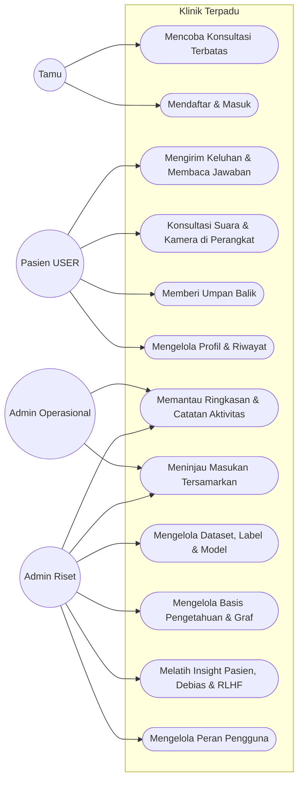
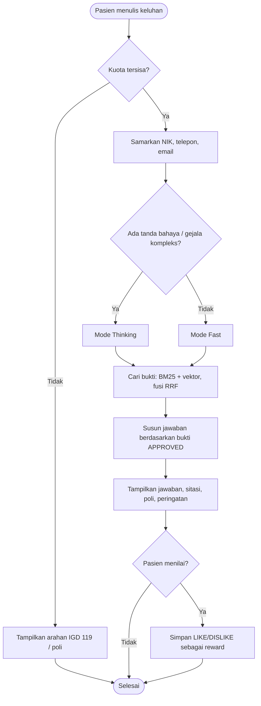
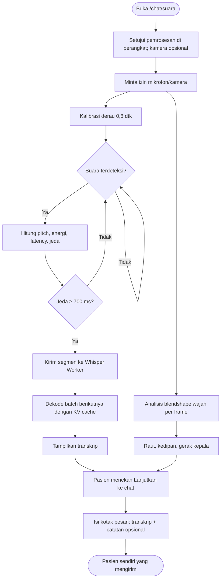
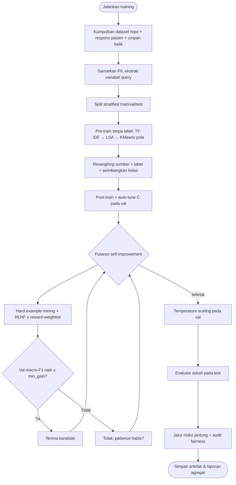
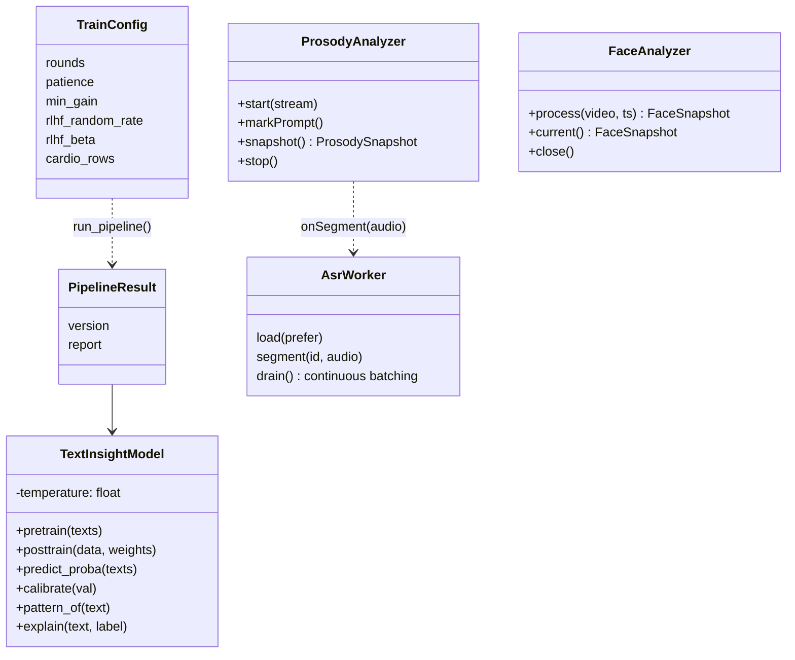
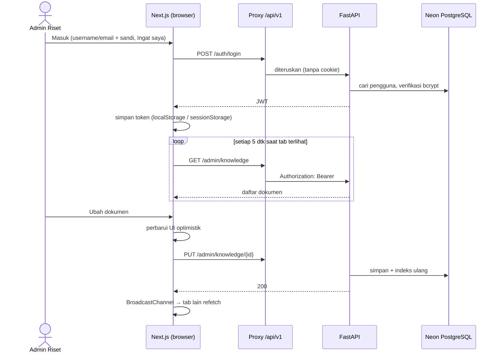
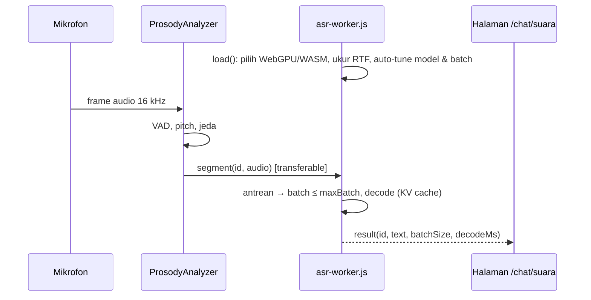

# Diagram Sistem Klinik Terpadu

Kumpulan diagram (ERD, use case, activity, UML; LRS ada di dokumen terpisah) yang selaras dengan kode pada rilis redesign PWA + Sprint 23. Ringkasan alur ada di [README](../../README.md#alur-aplikasi).

> ERD dan LRS dibangkitkan dari model SQLAlchemy. Penelusuran diagram ke fase Waterfall, kode, dan tes ada di [SYSTEM_MODELING_5_ELEMENTS.md](SYSTEM_MODELING_5_ELEMENTS.md).

> **Konvensi penamaan:** use case, aksi activity, dan pesan sequence ditulis sebagai kalimat kata kerja (*Mengirim Keluhan*, *Samarkan data pribadi*). Nama operasi yang sama dengan kode (`run_pipeline()`) tetap ditulis apa adanya.

### 1. Entity Relationship Diagram (ERD)

Lima modul, 13 tabel. Gambar: `diagrams/erd-1-akun-akses.svg` … `erd-5-graf-pengetahuan.svg`. Detail: [ERD.md](ERD.md).

### 2. Logical Record Structure (LRS)

Gambar: `diagrams/lrs-1-akun-akses.svg` … `lrs-5-graf-pengetahuan.svg`. Detail: [LRS.md](LRS.md).

### 3. Use Case Diagram & Spesifikasi Aktor

| Aktor | Spesifikasi |
|---|---|
| Tamu | Belum login; kuota percobaan terbatas |
| Pasien (`USER`) | Pemilik data konsultasi; satu-satunya yang bisa membaca isi chatnya |
| Admin Operasional (`ADMIN`) | Pemantau; tidak bisa membuka chat pasien atau fitur riset |
| Admin Riset (`RESEARCHER`) | Superadmin riset & pengguna; tetap tidak bisa membuka chat pasien |

### 4. Activity Diagram

**4.1. Konsultasi teks**

**4.2. Konsultasi suara & kamera (on-device)**

**4.3. Pipeline insight pasien (Admin Riset)**

### 5. Unified Modeling Language (UML) Diagrams

**5.1. Class diagram — pipeline insight & analisis on-device**

**5.2. Sequence diagram — login & real-time CRUD**

**5.3. Sequence diagram — ASR on-device**

