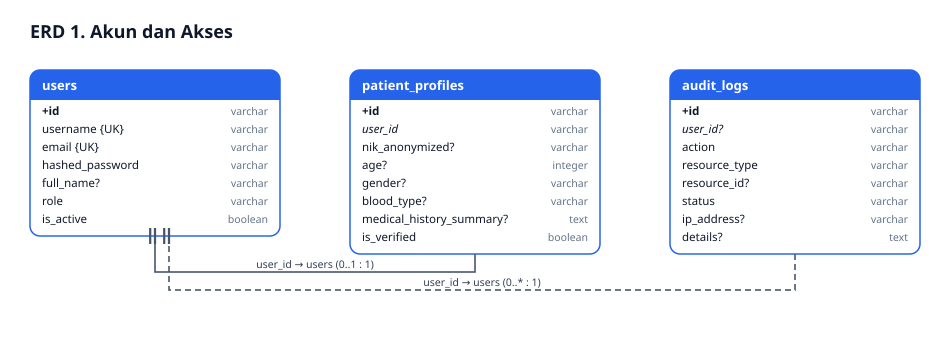
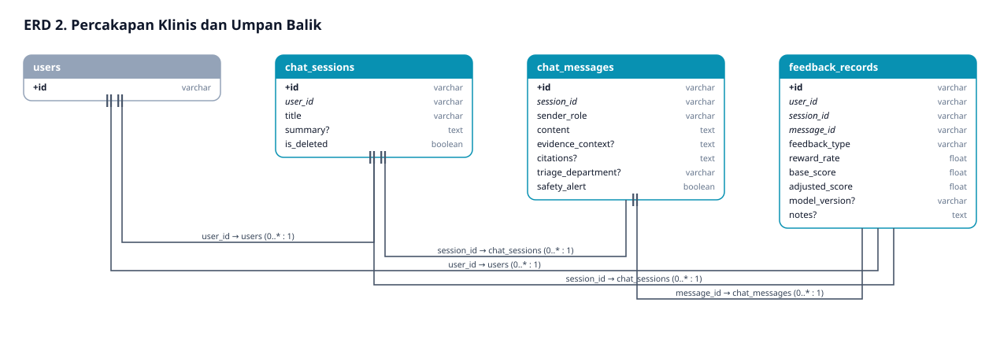
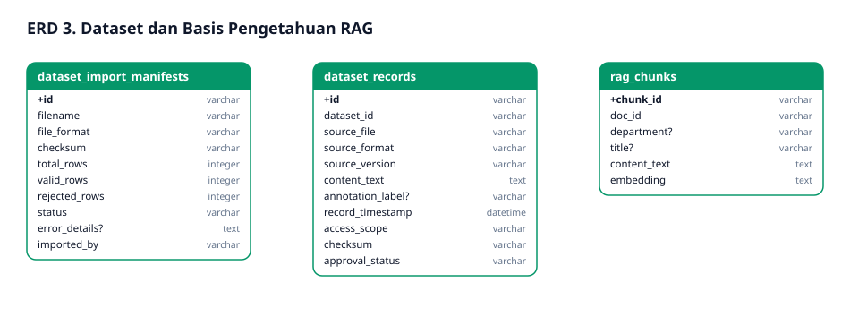
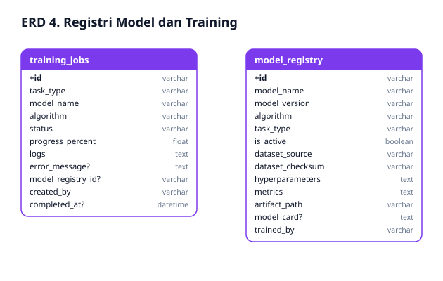
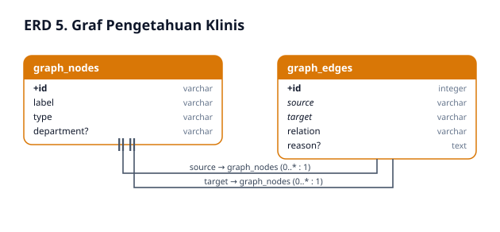
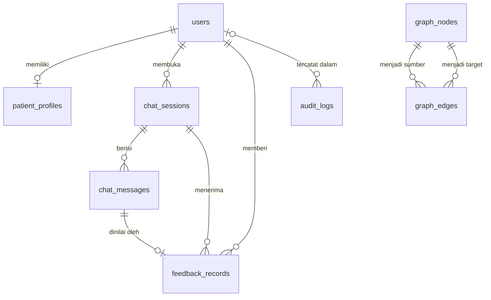

# Entity-Relationship Diagram (ERD) & Kamus Arsitektur Data

## TOGAF ADM: Phase C — Data Architecture

Skema dibangkitkan dari model SQLAlchemy (`services/ai-api/app/models.py`, `models_graph.py`, `models_rag.py`) dan migrasi Alembic (`database/migrations/versions/`). Produksi memakai PostgreSQL (Neon); lokal dan tes memakai SQLite.

## 1. Visual Entity-Relationship Diagram

Cara membaca: kotak berwarna adalah tabel modul; kotak abu-abu adalah tabel modul lain (hanya PK). `+id` = primary key, *miring* = foreign key, `{UK}` = unik, `?` = boleh kosong. Garis putus-putus = FK *nullable*. Kolom `created_at`/`updated_at` tidak digambar.

**1.1. Akun dan Akses**

**1.2. Percakapan Klinis dan Umpan Balik**

**1.3. Dataset dan Basis Pengetahuan RAG**

**1.4. Registri Model dan Training**

**1.5. Graf Pengetahuan Klinis**

## 2. Inventarisasi Tabel Operasional Basis Data

| Modul | Tabel | Kolom kunci | Keterangan |
|---|---|---|---|
| Akun & akses | `users` | `id`, `username{UK}`, `email{UK}`, `role`, `is_active` | Peran `USER`/`ADMIN`/`RESEARCHER` |
| | `patient_profiles` | `user_id{UK}` → users | Usia, gender, golongan darah, ringkasan riwayat, `nik_anonymized` |
| | `audit_logs` | `user_id?` → users (`SET NULL`) | Aksi, sumber daya, status, IP, detail |
| Percakapan | `chat_sessions` | `user_id` → users (`CASCADE`) | `summary`, `is_deleted` (soft delete) |
| | `chat_messages` | `session_id` → chat_sessions (`CASCADE`) | `sender_role`, `content`, `citations`, `triage_department`, `safety_alert` |
| | `feedback_records` | `user_id`, `session_id`, `message_id` | `feedback_type` LIKE/DISLIKE, `reward_rate`, `adjusted_score`, `model_version` |
| Data & pengetahuan | `dataset_records` | `dataset_id`, `checksum` | `approval_status`, `access_scope`, `annotation_label` (dokumen CRUD = `source_format KNOWLEDGE`) |
| | `dataset_import_manifests` | `checksum` | Statistik impor (baris valid/ditolak) |
| | `rag_chunks` | `chunk_id` | Potongan teks + `embedding` untuk RAG |
| Model | `model_registry` | `model_name`, `model_version`, `is_active` | Hiperparameter, metrik, artefak, model card |
| | `training_jobs` | `model_registry_id?` | Status, progres, log |
| Graf | `graph_nodes` | `id`, `type`, `department?` | Penyakit, gejala, obat, departemen, pedoman |
| | `graph_edges` | `source`, `target` → graph_nodes | `relation`, `reason` |

## 3. Resolusi Keputusan Desain Data Kritis

### 3.1 Satu Akun = Satu Profil Pasien
`patient_profiles.user_id` unik, sehingga relasi `users` ↔ profil bersifat 1 : 0..1.

### 3.2 Dokumen Pengetahuan Memakai Ulang `dataset_records`
CRUD basis pengetahuan tidak membuat tabel baru. Pemetaannya: `title` → `source_file`, `department` → `annotation_label`, `content` → `content_text`, `source` → `source_version`, ditandai `source_format = "KNOWLEDGE"`.

### 3.3 Integritas Umpan Balik
`feedback_records.message_id` menunjuk pesan asisten yang dinilai. Pipeline insight memasangkan pesan pasien sebelumnya dengan umpan balik itu. Label poli hanya dipakai bila umpan baliknya LIKE.

### 3.4 Perlindungan Privasi Data Pribadi (UU PDP No. 27/2022)
Tidak ada kolom untuk video/audio karena keduanya tidak pernah dikirim ke server. NIK hanya disimpan dalam bentuk anonim. Teks chat disamarkan sebelum masuk pipeline ML.
