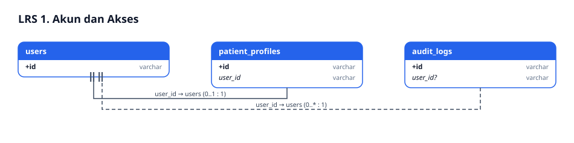
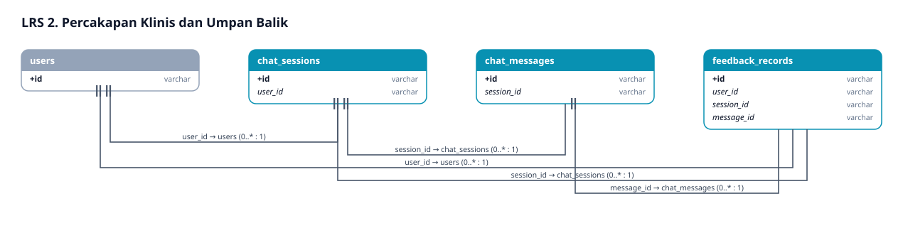
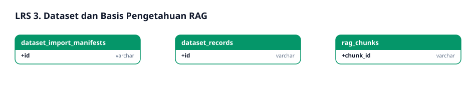
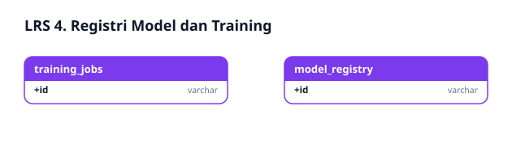
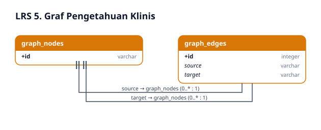

# Logical Record Structure (LRS) Klinik Terpadu

## 1. Cara membaca diagram

Setiap kotak adalah satu *record*. Hanya PK (`+`) dan FK (*miring*) yang digambar, karena LRS fokus pada keterhubungan. Panah menunjuk record yang dirujuk; label menyebut kolom FK dan kardinalitas.

## 2. Aturan transformasi ERD ke LRS

1. Setiap entitas menjadi satu record dengan PK yang sama.
2. Relasi 1 : N → FK di sisi N (mis. `chat_messages.session_id`).
3. Relasi 1 : 0..1 → FK unik di sisi opsional (`patient_profiles.user_id`).
4. Relasi M : N antar-node graf → record penghubung `graph_edges(source, target)`.
5. Atribut multi-nilai (sitasi, konteks bukti, hiperparameter, metrik) disimpan sebagai JSON teks: pengecualian terkendali, lihat bagian 6.

## 3. Diagram LRS per modul

### 3.1. Akun dan Akses


### 3.2. Percakapan Klinis


### 3.3. Dataset dan Pengetahuan


### 3.4. Model dan Training


### 3.5. Graf Pengetahuan


## 4. Matriks relasi dan aturan integritas

| Record anak | FK | Record induk | Kardinalitas | `ON DELETE` |
|---|---|---|---|---|
| `patient_profiles` | `user_id` (unik) | `users` | 0..1 : 1 | `CASCADE` |
| `chat_sessions` | `user_id` | `users` | 0..* : 1 | `CASCADE` |
| `chat_messages` | `session_id` | `chat_sessions` | 0..* : 1 | `CASCADE` |
| `feedback_records` | `user_id` | `users` | 0..* : 1 | `CASCADE` |
| `feedback_records` | `session_id` | `chat_sessions` | 0..* : 1 | `CASCADE` |
| `feedback_records` | `message_id` | `chat_messages` | 0..1 : 1 | `CASCADE` |
| `audit_logs` | `user_id` (nullable) | `users` | 0..* : 0..1 | `SET NULL` (jejak audit tetap ada) |
| `graph_edges` | `source`, `target` | `graph_nodes` | 0..* : 1 | `CASCADE` |

## 5. Daftar LRS (bentuk teks)

```
users(+id, username, email, hashed_password, full_name, role, is_active, created_at, updated_at)
patient_profiles(+id, user_id*, nik_anonymized, age, gender, blood_type, medical_history_summary, is_verified, ...)
chat_sessions(+id, user_id*, title, summary, is_deleted, ...)
chat_messages(+id, session_id*, sender_role, content, evidence_context, citations, triage_department, safety_alert, created_at)
feedback_records(+id, user_id*, session_id*, message_id*, feedback_type, reward_rate, base_score, adjusted_score, model_version, notes, created_at)
audit_logs(+id, user_id*, action, resource_type, resource_id, status, ip_address, details, created_at)
dataset_records(+id, dataset_id, source_file, source_format, source_version, content_text, annotation_label, record_timestamp, access_scope, checksum, approval_status, created_at)
dataset_import_manifests(+id, filename, file_format, checksum, total_rows, valid_rows, rejected_rows, status, error_details, imported_by, created_at)
rag_chunks(+chunk_id, doc_id, department, title, content_text, embedding)
model_registry(+id, model_name, model_version, algorithm, task_type, is_active, dataset_source, dataset_checksum, hyperparameters, metrics, artifact_path, model_card, trained_by, created_at)
training_jobs(+id, task_type, model_name, algorithm, status, progress_percent, logs, error_message, model_registry_id, created_by, created_at, completed_at)
graph_nodes(+id, label, type, department)
graph_edges(+id, source*, target*, relation, reason)
```
(`*` = foreign key)

## 6. Normalisasi dan pengecualian terkendali

- Tabel inti sudah memenuhi 3NF: atribut non-kunci bergantung penuh pada PK.
- **Pengecualian:** `citations`, `evidence_context`, `hyperparameters`, `metrics`, `logs` disimpan sebagai JSON teks. Isinya selalu dibaca utuh, tidak dicari per elemen, dan bentuknya berubah antar-versi model.
- `rag_chunks.doc_id` dan `training_jobs.model_registry_id` sengaja tidak diberi FK fisik, agar pengindeksan ulang dan pembersihan artefak tidak saling mengunci.

## 7. Keterkaitan dengan fase Waterfall berikutnya

LRS ini diimplementasikan langsung sebagai model SQLAlchemy dan migrasi Alembic (fase implementasi), lalu diverifikasi oleh tes yang membuat skema di SQLite sementara (fase pengujian). Bila skema berubah, bangkitkan ulang SVG dengan generator diagram, lalu perbarui ERD.md, LRS.md, dan README bersama-sama.
