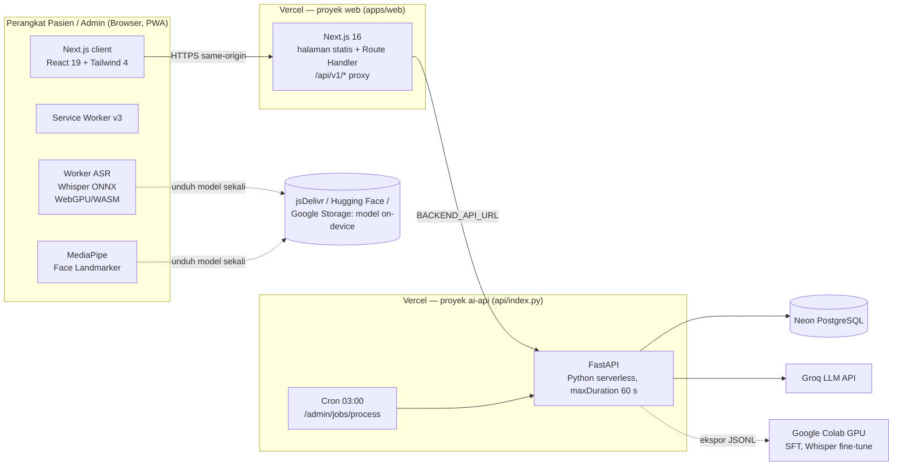

# Arsitektur Teknologi & Infrastruktur Sistem (Technology Architecture)

## TOGAF ADM: Phase D — Technology Architecture

## 1. Diagram Arsitektur Teknologi (Mermaid Deployment Diagram)

## 2. Komponen Teknologi & Standar Implementasi

| Lapisan | Teknologi | Catatan |
|---|---|---|
| Frontend | Next.js 16.4 (Turbopack), React 19.3, Tailwind CSS 4, TanStack Query 5, lucide-react | `cacheComponents`, header keamanan di `next.config.ts` |
| Proxy | Next.js Route Handler `app/api/v1/[...path]` | Meneruskan ke `BACKEND_API_URL`, tanpa cookie, pesan 502 generik |
| Backend | FastAPI, Pydantic 2, SQLAlchemy 2, Alembic, PyJWT, bcrypt | Router: auth, chat, admin, rag, knowledge, graph_crud, jobs, insights |
| ML server | scikit-learn, NumPy, pandas, joblib | CPU saja; artefak di `models/` atau `/tmp` |
| RAG | FTS (BM25) + vektor 384-d, fusi RRF | `app/rag/*`, backend PostgreSQL di produksi |
| LLM | Groq (model utama + cadangan via env) | `GROQ_API_KEY` |
| Cache | Redis bila `REDIS_URL` ada, jika tidak in-memory | `app/cache.py` |
| On-device | MediaPipe tasks-vision 1.2.2, transformers.js 4.3.2 (Whisper base/tiny) | Dimuat dari CDN saat runtime |
| Training GPU | Transformers, PEFT/LoRA, TRL, Optimum ONNX | `scripts/run_sft.py`, `scripts/colab/asr_whisper_finetune.py` |
| Hosting | Vercel (2 proyek), Neon | Domain `klinik-terpadu.vercel.app` |

## 3. Matriks Perbedaan Lingkungan: Lokal vs Staging vs Produksi

| Aspek | Lokal | Preview Vercel | Produksi |
|---|---|---|---|
| Database | SQLite (`DATABASE_URL` kosong) | Neon (branch) | Neon |
| `ENVIRONMENT` | `development` | `production` | `production` |
| `/docs`, `/openapi.json` | Aktif | Mati (kecuali `ENABLE_API_DOCS=1`) | Mati |
| CORS | localhost:3000/8000 | Origin terdaftar | `klinik-terpadu`, `web-omega-nine-24` + `CORS_ORIGINS` |
| Service worker | Tidak didaftarkan (dev) | Aktif | Aktif |
| Akun awal `admin`/`periset` | Dibuat bila belum ada | Hanya bila `ADMIN_BOOTSTRAP_PASSWORD` diisi | Sama |
| JWT secret | Boleh bawaan (diberi peringatan) | Wajib | Wajib (start ditolak bila bawaan) |
| Artefak model | `services/ai-api/models/` | `/tmp` (per instance) | `/tmp` (per instance) |
