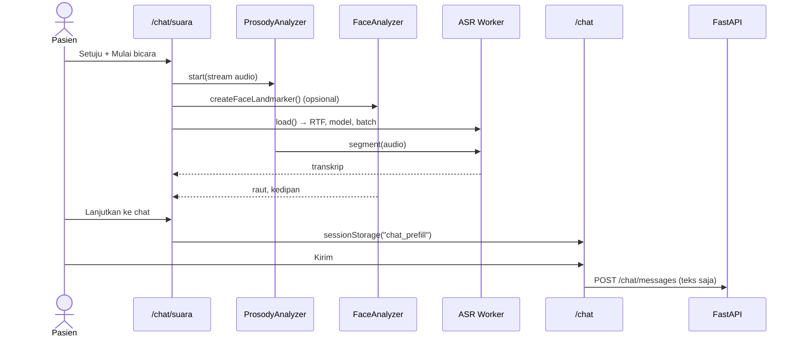

# 🏛️ Enterprise Service Architecture & Client-Side Media Processing

## 📋 Daftar Isi
1. Latar Belakang & Masalah Arsitektur Tradisional
2. Solusi Enterprise: Client-Side Offloading Pattern
3. Dekomposisi Domain Layanan
4. Mekanisme Keamanan (Batas Kepercayaan)
5. Penyimpanan & Caching di Frontend (PWA)
6. Format Keluaran: Transkrip & Catatan Non-Verbal
7. Sequence Diagram Alur Konsultasi Suara
8. Spesifikasi Kontrak Payload
9. Kesimpulan & Keunggulan bagi Pasien dan Server

## 1. Latar Belakang & Masalah Arsitektur Tradisional

### Masalah: "Server-Side Media Processing Bottleneck"
Analisis wajah, intonasi, dan pengenalan suara di server berarti: (a) mengunggah video/audio pasien, yaitu data biometrik sensitif; (b) butuh GPU, sedangkan fungsi Vercel hanya CPU dengan batas 60 detik; (c) latensi jaringan membuat analisis tidak real-time.

## 2. Solusi Enterprise: Client-Side Offloading Pattern

Semua pemrosesan media dipindah ke perangkat pasien:
- **Web Audio API** (16 kHz): VAD, pitch, jeda, latency, energi (`lib/voice/prosody.ts`).
- **MediaPipe Face Landmarker** (GPU → fallback CPU): blendshape → raut, kedipan, pose kepala (`lib/vision/face.ts`).
- **Whisper via transformers.js** di **Web Worker** (WebGPU → fallback WASM): ASR tanpa memblokir UI, dengan KV cache, continuous batching, dan auto-tuning (`public/workers/asr-worker.js`).

Server hanya menerima teks yang disetujui pasien, lewat rute chat yang sudah ada.

## 3. Dekomposisi Domain Layanan

| Domain | Layanan | Lokasi | Skala |
|---|---|---|---|
| Identitas & akses | Auth, profil, RBAC | FastAPI `routes/auth.py`, `security/` | Serverless |
| Konsultasi | Chat, SSE, kuota, umpan balik | `routes/chat.py`, `agents/` | Serverless + Groq |
| Pengetahuan | RAG, basis pengetahuan, graf | `rag/`, `routes/knowledge.py`, `graph_crud.py` | Serverless + Neon |
| Riset ML | Dataset, model, evaluasi, insight | `routes/admin.py`, `routes/insights.py`, `ml/` | Serverless (CPU) + Colab (GPU) |
| Pekerjaan latar | Proses antrean harian | `routes/jobs.py` + cron | Terjadwal |
| Media on-device | Prosodi, wajah, ASR | Browser pasien | Perangkat |
| Gerbang | Proxy same-origin, header keamanan | Next.js route handler, `next.config.ts` | Edge/serverless |

Saat ini backend di-deploy sebagai **satu aplikasi FastAPI modular** (modular monolith). Batas domain di atas memungkinkan pemecahan menjadi layanan terpisah bila beban menuntut.

## 4. Mekanisme Keamanan (Batas Kepercayaan)

- Browser hanya bicara ke origin sendiri. Proxy meneruskan ke backend tanpa cookie, dan error internal tidak diteruskan.
- Model on-device dimuat dari CDN dengan versi dipatok (`tasks-vision@1.2.2`, `transformers@4.3.2`). Karena dimuat lewat `import()` dinamis, belum ada Subresource Integrity. Ini risiko rantai pasok yang tercatat. Mitigasi lanjutan: *self-host* berkas model & wasm di `public/`.
- Hasil analisis media tidak dipakai untuk keputusan otomatis apa pun di server.

## 5. Penyimpanan & Caching di Frontend (PWA)

- Model Whisper/MediaPipe di-cache oleh browser/transformers.js setelah unduhan pertama.
- Service worker tidak menyimpan HTML, API, atau stream. Hanya aset statis ber-hash dan halaman offline.
- Teks prefill memakai `sessionStorage` dan dihapus segera setelah dibaca halaman chat.

## 6. Format Keluaran: Transkrip & Catatan Non-Verbal

### 1. Transkrip
Gabungan teks segmen ucapan (bahasa Indonesia, `task: transcribe`).

### 2. Catatan non-verbal (opsional)
Satu kalimat dalam kurung siku: latency mulai bicara, jumlah & rata-rata jeda, kontur intonasi akhir, dan kecenderungan raut, diakhiri "Ini hanya indikasi, bukan diagnosis."

## 7. Sequence Diagram Alur Konsultasi Suara



## 8. Spesifikasi Kontrak Payload

### Endpoint:
`POST /api/v1/chat/messages` (tidak ada endpoint media baru).
### Headers:
`Authorization: Bearer <token>`, `Content-Type: application/json`.
### Otorisasi:
Peran `USER` (admin ditolak `403`).
### Contoh payload:
```json
{ "content": "Sudah tiga hari saya pusing dan mual.\n\n[Catatan otomatis dari perangkat saya: mulai bicara setelah 1.4 dtk, 2 jeda (rata-rata 520 ms), intonasi akhir turun, raut wajah cenderung tegang. Ini hanya indikasi, bukan diagnosis.]" }
```

## 9. Kesimpulan & Keunggulan bagi Pasien dan Server

- **Pasien:** wajah dan suaranya tidak pernah meninggalkan perangkat; pasien melihat dan menyetujui teks sebelum dikirim.
- **Server:** tidak butuh GPU, tidak menyimpan media, dan payload tetap kecil.
- **Trade-off:** butuh unduhan model sekali, dan performa bergantung perangkat. Ini ditangani dengan auto-tuning tiny/base dan ukuran batch.
