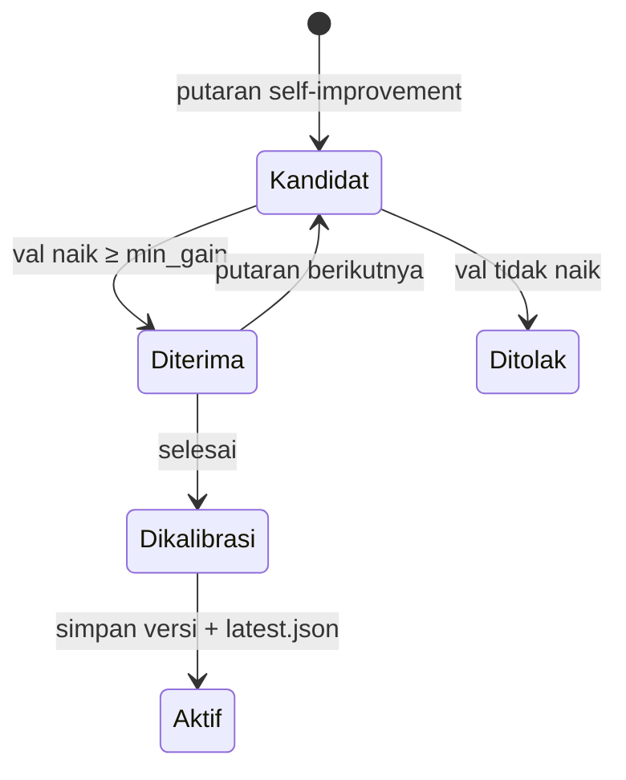

# Matriks Hak Akses Berbasis Peran (RBAC Matrix) & Arsitektur Bisnis

## 1. Definisi Aktor Sistem

| Aktor | Kode | Cara mendapat peran |
|---|---|---|
| Tamu | — | Tanpa akun; kuota percobaan |
| Pasien | `USER` | Mendaftar di `/register` |
| Admin Operasional | `ADMIN` | Diberikan Admin Riset |
| Admin Riset (superadmin) | `RESEARCHER` | Diberikan Admin Riset lain / akun awal `periset` |

## 2. Matriks Hak Akses Sumber Daya (Resource Access Matrix)

| Sumber daya | Create | Read | Update | Delete |
|---|---|---|---|---|
| `users` | Publik (hanya `USER`) | Diri sendiri; `ADMIN`/`RESEARCHER` (daftar) | Diri sendiri (profil); peran & status: `RESEARCHER` | — |
| `patient_profiles` | Pemilik | Pemilik | Pemilik | (ikut user) |
| `chat_sessions` / `chat_messages` | Pemilik (`USER`) | **Pemilik saja** | — | Pemilik (soft delete) |
| `feedback_records` | Pemilik | `ADMIN`/`RESEARCHER` (isi chat disamarkan) | `ADMIN`/`RESEARCHER` (catatan) | — |
| `dataset_records` (termasuk dokumen pengetahuan) | `RESEARCHER` | `ADMIN` (pengetahuan), `RESEARCHER` | `RESEARCHER` | `RESEARCHER` |
| `graph_nodes` / `graph_edges` | `RESEARCHER` | `ADMIN` (skema), `RESEARCHER` | `RESEARCHER` | `RESEARCHER` |
| `model_registry` / `training_jobs` | `RESEARCHER` | `RESEARCHER` | `RESEARCHER` (aktivasi) | — |
| Laporan & artefak insight | `RESEARCHER` | `RESEARCHER` | — | — |
| `audit_logs` | Sistem | `ADMIN`/`RESEARCHER` | — | — |

## 3. Resolusi Keputusan Bisnis: Akses Admin ke Chat Pasien (ADR-05)

### Latar Belakang & Masalah
Versi awal memungkinkan admin membuka percakapan pasien untuk "peninjauan". Percakapan berisi keluhan kesehatan, yang menurut UU PDP termasuk data pribadi spesifik, dan pasien tidak pernah menyetujui pembacaan oleh pihak lain.

### Keputusan Arsitektur
- Semua admin (termasuk superadmin riset) **diblokir** dari rute `/chat/*` di server.
- Peninjauan kualitas memakai umpan balik dengan isi tersamarkan.
- Pipeline insight memakai teks pasien **hanya di dalam proses server** (setelah masking), hanya mengembalikan agregat, dan tidak pernah mengekspornya.

## 4. State Machine & Alur Siklus Hidup Layanan

### 4.1. Siklus Hidup Dataset / Dokumen Pengetahuan

```mermaid
stateDiagram-v2
    [*] --> PENDING: unggah / buat
    PENDING --> APPROVED: Admin Riset setujui
    PENDING --> REJECTED
    PENDING --> QUARANTINED: format/isi bermasalah
    APPROVED --> Terindeks: index / reindex
    Terindeks --> APPROVED: ubah isi (indeks disinkronkan)
    APPROVED --> [*]: hapus
```

### 4.2. Siklus Hidup Model Insight

## 5. Kriteria Penerimaan yang Dapat Diuji (*Testable Acceptance Criteria*)

### Skenario 1: Isolasi Data Antar Pasien
Pasien A meminta `GET /chat/sessions/{id_milik_B}` → `404`. Daftar sesi hanya memuat milik sendiri.

### Skenario 2: Pemisahan Tugas Admin
`ADMIN` memanggil `POST /admin/insights/train` atau `PATCH /admin/users/{id}` → `403`. `RESEARCHER` → diproses. (`test_rbac_matrix.py`, `test_patient_insights.py::test_rbac_only_researcher`)

### Skenario 3: Admin Tidak Bisa Membuka Chat
`ADMIN`/`RESEARCHER` memanggil `POST /chat/messages` → `403`; layout `/chat` menampilkan pesan khusus admin. (`services/ai-api/tests/test_chat_block.py`)

### Skenario 4: Tidak Ada Kebocoran Chat di Insight
Pesan pasien berpenanda unik tidak muncul di respons `POST /admin/insights/train` maupun berkas ekspor Colab. (`test_train_and_predict_api_without_leaking_chat`, `test_colab_export_excludes_patient_chat_and_blocks_traversal`)
