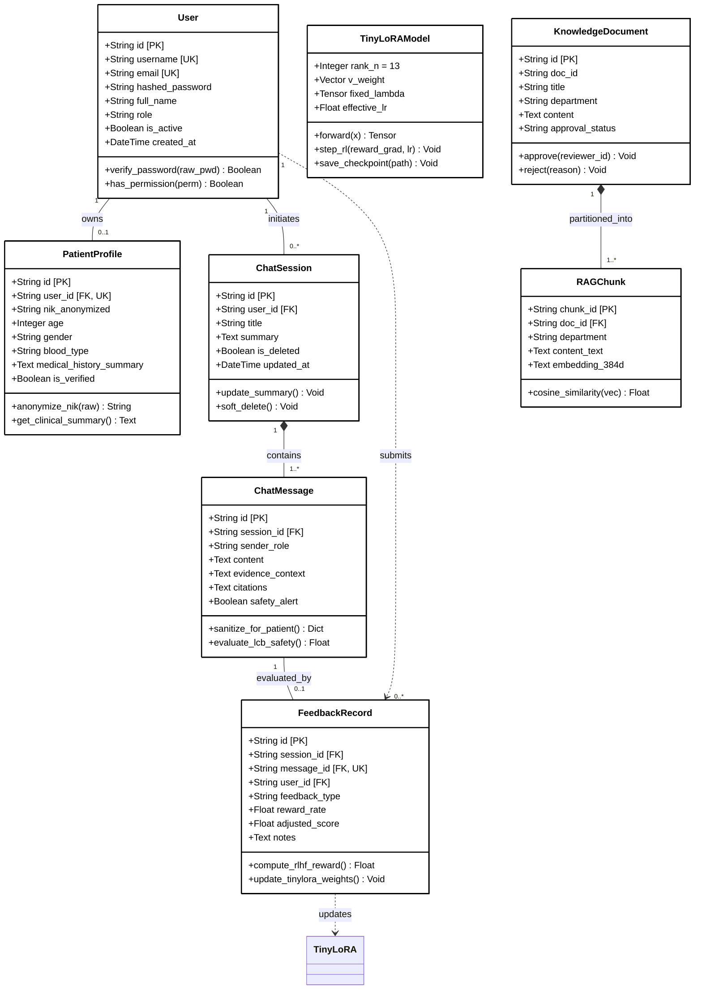
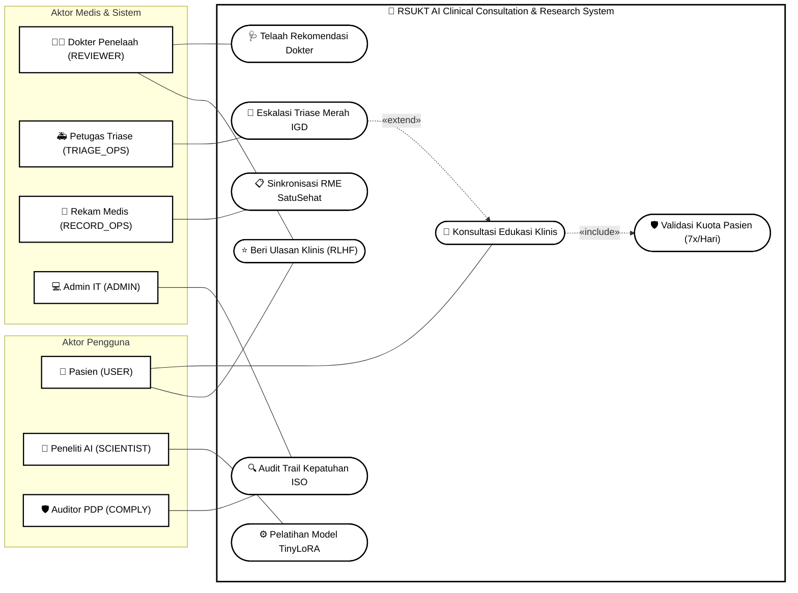
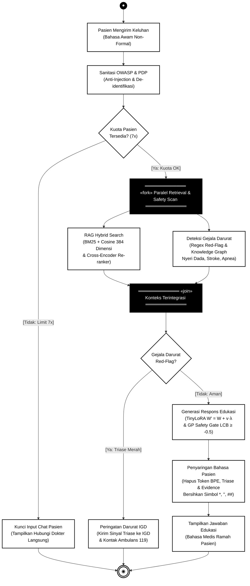
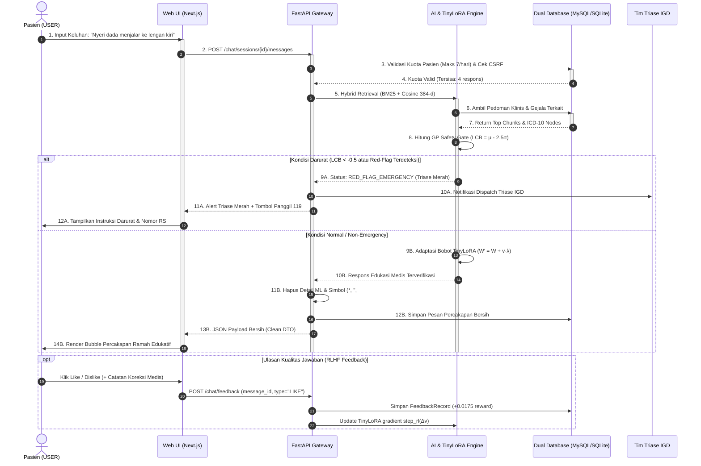
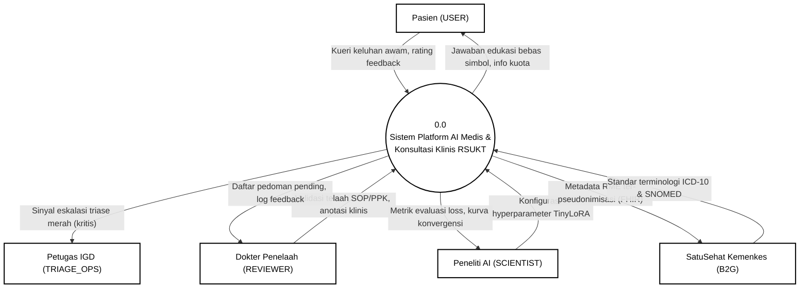

# Dokumen UML, Diagram Arsitektur, & Aliran Data Sistem
## RSUKT AI Clinical Consultation & Research Intelligence Platform
### Standar Template Formal Hitam Putih (Monochrome Engineering Specification)

---

### Informasi Dokumen & Visual Suite
- **Modul Dokumentasi:** Visual UML, Dynamic Behavioral Diagrams, & DFD Level 0/1
- **Tema Visual:** **Hitam Putih Murni (Monochrome / Grayscale)** sesuai standar dokumentasi teknik formal, bebas warna berlebih untuk keterbacaan tinggi (*high-contrast engineering specification*).
- **Live Interactive Animated Viewer:** [`interactive_system_diagrams.html`](file:///c:/Users/user/RAG-model-record/docs/readme/interactive_system_diagrams.html) *(Dilengkapi animasi garis alur hitam putih, kontrol jeda/putar, zoom interaktif, dan tab navigasi)*
- **Standar Garis Relasi:** Mengikuti template referensi resmi (Visual Paradigm / UML 2.5 / Crow's Foot ERD) dengan pemisahan ortogonal rapi (*clean non-overlapping routing*) guna mencerminkan standar integritas ANSI SQL (MySQL 8.0 & SQLite 3.35+).

---

## ⚡ Interactive Animated Diagrams Suite (Live Preview)

Sistem menyediakan aplikasi visual interaktif beranimasi penuh bertema Hitam Putih (Monochrome) yang dapat dibuka langsung di browser:
- **Lokasi File Dokumen:** [`docs/readme/interactive_system_diagrams.html`](file:///c:/Users/user/RAG-model-record/docs/readme/interactive_system_diagrams.html)
- **Aplikasi Web Publik:** [`apps/web/public/interactive_system_diagrams.html`](file:///c:/Users/user/RAG-model-record/apps/web/public/interactive_system_diagrams.html)

*Fitur Animasi:*
1. **Flow Dash Animation:** Garis relasi dan kueri bergaris putus-putus hitam bergerak kontinu (`stroke-dasharray` dengan animasi linier).
2. **Pulsing Activation Blocks:** Blok keputusan berkedip secara halus saat mengevaluasi kondisi.
3. **Interactive Controls:** Tombol Play/Pause animasi, Zoom In (+), Zoom Out (-), dan Reset View.

---

## 1. Class Diagram (UML)
*Template Mengikuti Gambar 1: Struktur 3-Kompartemen Hitam Putih (Header Kelas, Atribut Tengah, Method Operasi Bawah, Relasi Kardinalitas)*

---

## 2. Use Case Diagram (7 Aktor)
*Template Mengikuti Gambar 2: Batas Sistem Persegi Panjang Hitam Putih (*System Boundary Box*), Aktor Stick-Figure, Oval Use Cases, Relasi `<<include>>` dan `<<extend>>`*

---

## 3. Activity Diagram (Alur Konsultasi & Triase Klinis)
*Template Mengikuti Gambar 3: Titik Awal Bulat Hitam (●), Action Rectangles Bersih Tanpa Terpotong, Decision Diamond (◇), Fork & Join Bars Hitam, dan Titik Akhir Target (◉)*

---

## 4. Sequence Diagram (Interaksi Konsultasi Real-Time)
*Template Mengikuti Gambar 4: Lifeline Vertikal Putus-Putus, Blok Aktivasi Persegi Panjang Hitam Putih, Panah Sinkron, Dashed Return Arrows, & Blok Fragmen `alt` / `opt`*

---

## 5. Data Flow Diagram (DFD Level 0 & Level 1)
*Template Mengikuti Standard: Entitas Eksternal (Persegi Garis Ganda), Proses (Lingkaran Hitam Putih), Data Store (= D1 =), dan Aliran Data Berarah*

### 5.1 DFD Level 0 (Context Diagram)

---

*Seluruh diagram pada dokumen ini menggunakan standar Hitam Putih (Monochrome) dan terintegrasi dengan Live Interactive Suite [`interactive_system_diagrams.html`](file:///c:/Users/user/RAG-model-record/docs/readme/interactive_system_diagrams.html).*
