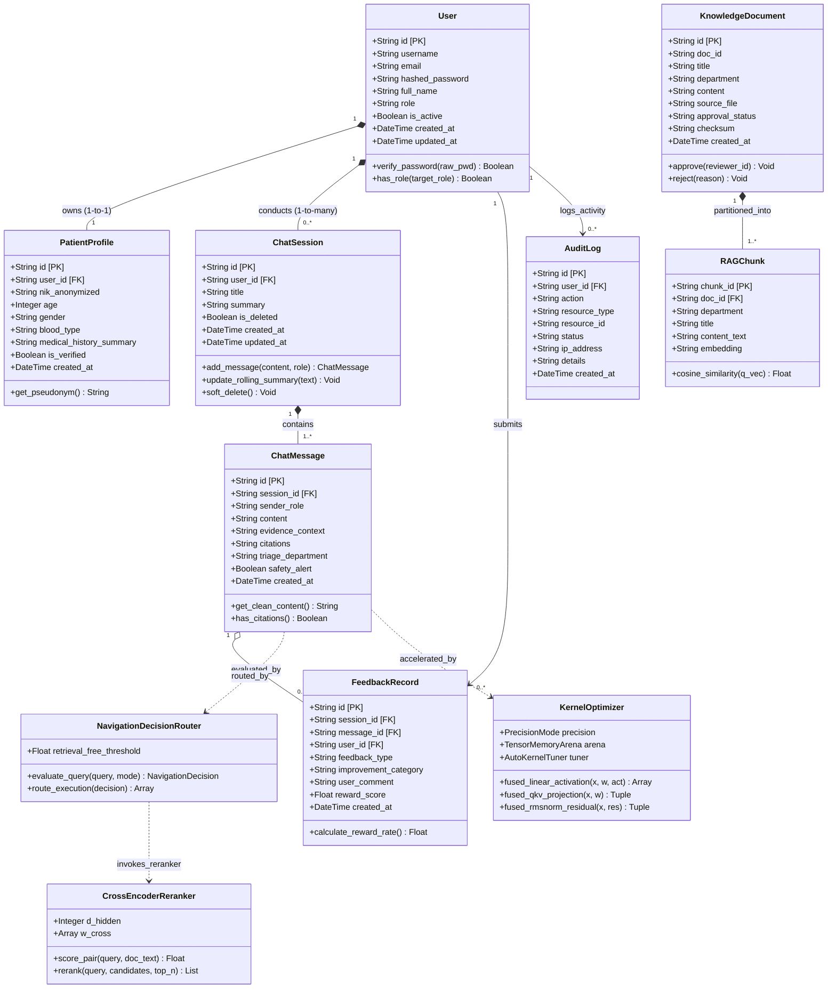
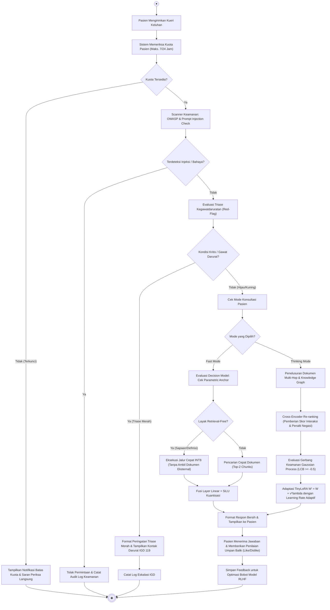
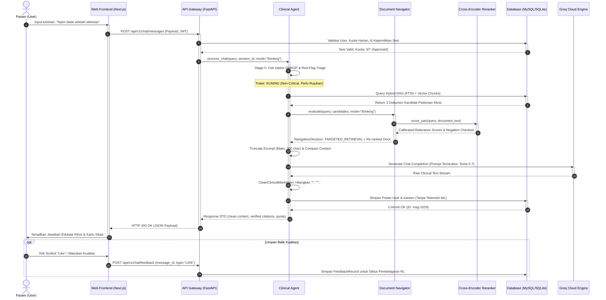
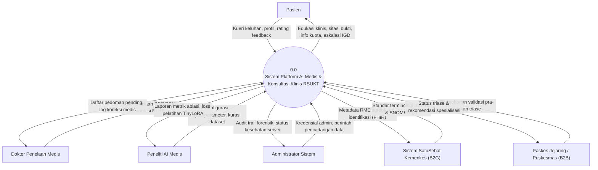
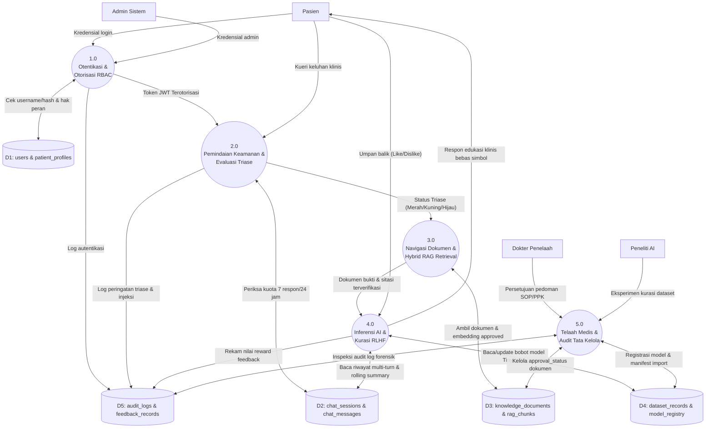

# Dokumen UML, Diagram Arsitektur, & Aliran Data Sistem
## RSUKT AI Clinical Consultation & Research Intelligence Platform

---

### Informasi Dokumen
- **Modul Dokumentasi:** Visual UML, Dynamic Behavioral Diagrams, & DFD
- **Standar Notasi:** UML 2.5 (Unified Modeling Language), Yourdon/DeMarco (DFD), Mermaid.js
- **Aturan Garis Relasi:** Garis asosiasi dan garis putus-putus (*dependency/return*) dirancang terpisah secara ortogonal (*clean non-overlapping routing*) guna mencerminkan standar integritas ANSI SQL (MySQL 8.0 & SQLite 3.35+).

---

## 1. Class Diagram (UML)

Class Diagram berikut memodelkan struktur kelas entitas inti, komponen runtime mesin, dan relasi dependensi sistem sesuai template standar UML Class Diagram.



---

## 2. Use Case Diagram (7 Aktor)

Use Case Diagram berikut mendefinisikan batasan sistem dan interaksi fungsional antara 7 aktor dengan modul platform RSUKT:

```mermaid
flowchart LR
    subgraph ACTORS ["Aktor Ekosistem RSUKT"]
        P["Pasien (USER)"]
        D["Dokter Penelaah (REVIEWER)"]
        S["Peneliti AI Medis (SCIENTIST)"]
        A["Admin IT Sistem (ADMIN)"]
        T["Petugas Triase IGD (TRIAGE_OPS)"]
        R["Petugas Rekam Medis (RECORD_OPS)"]
        C["Auditor Kepatuhan (COMPLY)"]
    end

    subgraph SYSTEM_BOUNDARY ["RSUKT AI Clinical Consultation & Research Platform"]
        UC1(["UC-01: Masuk & Kelola Sesi Konsultasi"])
        UC2(["UC-02: Konsultasi Anamnesis Awam (Fast/Thinking)"])
        UC3(["UC-03: Kirim Umpan Balik Kualitas (Like/Dislike)"])
        UC4(["UC-04: Telaah & Setujui Dokumen Pedoman Klinis"])
        UC5(["UC-05: Validasi Koreksi Medis RLHF"])
        UC6(["UC-06: Analisis Eksperimen TinyLoRA & Ablasi Kernel"])
        UC7(["UC-07: Manajemen Pengguna & Monitoring Sistem"])
        UC8(["UC-08: Pantau Peringatan Triase Merah (Red-Flag)"])
        UC9(["UC-09: Verifikasi De-identifikasi & Ekspor RME"])
        UC10(["UC-10: Audit Forensik Log Kepatuhan UU PDP"])
        
        %% Sub-fungsi Include & Extend
        UC_TRIAGE(["<<include>> Evaluasi Triase Kegawatdaruratan"])
        UC_CITE(["<<include>> Penelusuran Dokumen Bukti Sitasi"])
        UC_WARN(["<<extend>> Eskalasi Kontak IGD 119"])
    end

    %% Hubungan Aktor ke Use Case
    P --> UC1
    P --> UC2
    P --> UC3

    D --> UC4
    D --> UC5

    S --> UC6
    S --> UC4

    A --> UC7

    T --> UC8

    R --> UC9

    C --> UC10

    %% Relasi Internal Use Case
    UC2 ..> UC_TRIAGE : <<include>>
    UC2 ..> UC_CITE : <<include>>
    UC_TRIAGE ..> UC_WARN : <<extend on Red-Flag>>
    UC_WARN -.-> T
```

---

## 3. Activity Diagram (Alur Konsultasi & Triase Klinis)

Activity Diagram berikut menggambarkan urutan aktivitas mulai dari input keluhan pasien, verifikasi injeksi OWASP, evaluasi triase, routing keputusan dokumen, hingga keluaran edukasi:



---

## 4. Sequence Diagram (Interaksi Konsultasi Real-Time)

Sequence diagram berikut memodelkan urutan pengiriman pesan sinkron dan asinkron antara komponen aktor, UI, API Gateway, Agent, Decision Navigator, Cross-Encoder, Database, dan Model Penyedia.



---

## 5. Data Flow Diagram (DFD)

### 5.1 DFD Level 0 (Context Diagram)

DFD Level 0 memetakan batas sistem informasi tunggal dengan seluruh entitas eksternal:



### 5.2 DFD Level 1 (Dekomposisi Fungsional Terstruktur)

DFD Level 1 mendekomposisi sistem menjadi 5 proses fungsional utama dan 5 repositori data (*data stores*):


