# Entity-Relationship Diagram (ERD) & Kamus Arsitektur Data Sistem
## RSUKT AI Clinical Consultation & Research Intelligence Platform
### Standar Kompatibilitas Ganda: MySQL 8.0, SQLite 3.35+, & PostgreSQL Neon

---

### Informasi Dokumen
- **ID Dokumen:** RSUKT-DOC-ERD-003
- **Versi:** 2.4.0 (Production Release)
- **Status:** Approved & Implemented
- **Target RDBMS:** 
  - Production Primary: PostgreSQL 16 (Neon Serverless Pooler)
  - On-Premise Enterprise Hospital: MySQL 8.0 (InnoDB Engine, utf8mb4)
  - Edge / Offline Clinic / Embedded Test: SQLite 3.35+ (WAL Mode, Foreign Keys Enforced)
- **Klasifikasi Data:** Terenkripsi & Ter-pseudonimisasi (UU PDP No. 27/2022 & ISO/IEC 27001)

---

## 1. Visual Entity-Relationship Diagram (ERD)

Diagram di bawah dirancang mengikuti standar diagram visual relasional (Crow's Foot Notation). Penataan kelompok entitas disusun secara bersegmen (modular domain) sehingga **garis relasi (termasuk garis putus-putus non-identifying dan garis solid identifying) tidak saling bersilangan (*clean orthogonal layout*)**:

```mermaid
erDiagram
    %% ==========================================
    %% DOMAIN 1: IDENTITAS, AKUN & PROFIL PASIEN
    %% ==========================================
    USERS ||--o| PATIENT_PROFILES : "memiliki profil pasien (1:0..1)"
    USERS ||--o{ CHAT_SESSIONS : "membuat sesi chat (1:N)"
    USERS ||--o{ FEEDBACK_RECORDS : "memberikan feedback (1:N)"
    USERS ||--o{ AUDIT_LOGS : "memicu aktivitas log (1:N)"

    USERS {
        VARCHAR_36 id PK "UUIDv4 string"
        VARCHAR_50 username UK "Unique alphanumeric identifier"
        VARCHAR_100 email UK "Email resmi pengguna"
        VARCHAR_255 hashed_password "Argon2id/Bcrypt hash"
        VARCHAR_100 full_name "Nama lengkap terverifikasi"
        VARCHAR_20 role "USER | ADMIN | REVIEWER | etc"
        BOOLEAN is_active "Status aktif akun (True/False)"
        DATETIME created_at "Timestamp akun dibuat (UTC)"
        DATETIME updated_at "Timestamp modifikasi terakhir"
    }

    PATIENT_PROFILES {
        VARCHAR_36 id PK "UUIDv4 string"
        VARCHAR_36 user_id FK,UK "Relasi 1:1 ke USERS (CASCADE)"
        VARCHAR_64 nik_anonymized "HMAC-SHA256 NIK Pasien (PDP)"
        INTEGER age "Usia pasien (Tahun)"
        VARCHAR_10 gender "Jenis kelamin (L / P)"
        VARCHAR_5 blood_type "Golongan darah (A, B, AB, O)"
        TEXT medical_history_summary "Ringkasan riwayat medis terenkripsi"
        BOOLEAN is_verified "Status verifikasi NIK Kemenkes"
        DATETIME created_at "Timestamp profil dibuat"
        DATETIME updated_at "Timestamp pembaruan profil"
    }

    %% ==========================================
    %% DOMAIN 2: KONSULTASI KLINIS & RLHF DIALOG
    %% ==========================================
    CHAT_SESSIONS ||--|{ CHAT_MESSAGES : "memiliki daftar pesan (1:N)"
    CHAT_SESSIONS ||--o{ FEEDBACK_RECORDS : "diasosiasikan dengan feedback (1:N)"
    CHAT_MESSAGES ||--o| FEEDBACK_RECORDS : "dievaluasi oleh feedback (1:0..1)"

    CHAT_SESSIONS {
        VARCHAR_36 id PK "UUIDv4 string"
        VARCHAR_36 user_id FK "Pemilik sesi (CASCADE)"
        VARCHAR_200 title "Judul percakapan klinis"
        TEXT summary "Ringkasan dialog otomatis AI"
        DATETIME created_at "Waktu inisiasi sesi"
        DATETIME updated_at "Waktu pesan terakhir masuk"
        BOOLEAN is_deleted "Soft delete flag"
    }

    CHAT_MESSAGES {
        VARCHAR_36 id PK "UUIDv4 string"
        VARCHAR_36 session_id FK "Relasi ke CHAT_SESSIONS (CASCADE)"
        VARCHAR_20 sender_role "user | assistant | system"
        TEXT content "Teks percakapan medis bersih"
        TEXT evidence_context "Konteks RAG / Excerpt terverifikasi"
        TEXT citations "JSON referensi jurnal / pedoman"
        VARCHAR_50 triage_department "Kardiologi | Neurologi | Umum"
        BOOLEAN safety_alert "Flag deteksi red-flag IGD"
        DATETIME created_at "Waktu pesan dikirim"
    }

    FEEDBACK_RECORDS {
        VARCHAR_36 id PK "UUIDv4 string"
        VARCHAR_36 user_id FK "Evaluator pesan (CASCADE)"
        VARCHAR_36 session_id FK "Sesi rujukan (CASCADE)"
        VARCHAR_36 message_id FK,UK "Pesan asisten yang dinilai (CASCADE)"
        VARCHAR_10 feedback_type "LIKE | DISLIKE"
        FLOAT reward_rate "Nilai RLHF (+0.0175 / -0.0074)"
        FLOAT base_score "Skor dasar keyakinan (default 0.5)"
        FLOAT adjusted_score "Skor akhir probabilitas reward"
        VARCHAR_50 model_version "Versi model AI yang dievaluasi"
        TEXT notes "Catatan koreksi klinis dokter"
        DATETIME created_at "Waktu rating diberikan"
    }

    %% ==========================================
    %% DOMAIN 3: KNOWLEDGE RETRIEVAL & RAG CHUNKS
    %% ==========================================
    DATASET_RECORDS ||--o{ RAG_CHUNKS : "dipecah menjadi potongan vektor (1:N)"

    DATASET_RECORDS {
        VARCHAR_36 id PK "UUIDv4 string"
        VARCHAR_50 dataset_id "Identifikasi domain dataset"
        VARCHAR_255 source_file "Nama file referensi pedoman"
        VARCHAR_20 source_format "CSV | TXT | JSONL | KNOWLEDGE"
        VARCHAR_50 source_version "Versi rilis pedoman klinis"
        TEXT content_text "Isi teks protokol medis lengkap"
        VARCHAR_100 annotation_label "Kategori / Departemen klinis"
        DATETIME record_timestamp "Waktu pencatatan data"
        VARCHAR_50 access_scope "PUBLIC | RESTRICTED | AUTHORIZED"
        VARCHAR_64 checksum "SHA-256 integritas dokumen"
        VARCHAR_30 approval_status "PENDING | APPROVED | REJECTED"
        DATETIME created_at "Timestamp registrasi data"
    }

    RAG_CHUNKS {
        VARCHAR_36 chunk_id PK "UUIDv4 hash segmen"
        VARCHAR_50 doc_id FK "ID rujukan ke DATASET_RECORDS"
        VARCHAR_100 department "Spesialisasi poliklinik rujukan"
        VARCHAR_400 title "Judul sub-bab pedoman klinis"
        TEXT content_text "Potongan teks terindeks BM25"
        TEXT embedding "Vektor embedding (JSON float 384 dim)"
    }

    DATASET_IMPORT_MANIFESTS {
        VARCHAR_36 id PK "UUIDv4 string batch import"
        VARCHAR_255 filename "Nama file arsip sumber"
        VARCHAR_20 file_format "Format arsip (ZIP/CSV/JSONL)"
        VARCHAR_64 checksum "SHA-256 verifikasi berkas"
        INTEGER total_rows "Total baris data diproses"
        INTEGER valid_rows "Jumlah baris lolos validasi"
        INTEGER rejected_rows "Jumlah baris gagal / anomali"
        VARCHAR_30 status "SUCCESS | PARTIAL | FAILED"
        TEXT error_details "Detail laporan kegagalan parsing"
        VARCHAR_50 imported_by "User/Admin pengunggah"
        DATETIME created_at "Waktu proses batch impor"
    }

    %% ==========================================
    %% DOMAIN 4: KNOWLEDGE GRAPH MEDIS
    %% ==========================================
    GRAPH_NODES ||--o{ GRAPH_EDGES : "simpul asal relasi (source)"
    GRAPH_NODES ||--o{ GRAPH_EDGES : "simpul tujuan relasi (target)"

    GRAPH_NODES {
        VARCHAR_100 id PK "ID entitas (mis: DX_HEART_FAILURE)"
        VARCHAR_300 label "Nama medis resmi (ICD-10 / SNOMED)"
        VARCHAR_30 type "Penyakit | Gejala | Obat | Poliklinik"
        VARCHAR_100 department "Departemen medis terkait"
    }

    GRAPH_EDGES {
        INTEGER id PK "Auto-increment serial"
        VARCHAR_100 source FK "Relasi ke GRAPH_NODES.id (CASCADE)"
        VARCHAR_100 target FK "Relasi ke GRAPH_NODES.id (CASCADE)"
        VARCHAR_40 relation "CAUSES | HAS_SYMPTOM | TREATED_BY"
        TEXT reason "Rasional medis berbasis bukti klinis"
    }

    %% ==========================================
    %% DOMAIN 5: ML REGISTRY, TRAINING & SECURITY AUDIT
    %% ==========================================
    MODEL_REGISTRY ||--o{ TRAINING_JOBS : "dihasilkan dari eksperimen job (0..1:N)"

    MODEL_REGISTRY {
        VARCHAR_36 id PK "UUIDv4 string"
        VARCHAR_100 model_name "Nama registrasi arsitektur model"
        VARCHAR_30 model_version "Versi semantik (mis: v2.4.0-rlhf)"
        VARCHAR_50 algorithm "TinyLoRA | CrossEncoder | GP_Gate"
        VARCHAR_50 task_type "TRIAGE_CLASSIFICATION | RAG_RERANK"
        BOOLEAN is_active "Status deployment aktif di produksi"
        VARCHAR_255 dataset_source "Sumber data pelatihan"
        VARCHAR_64 dataset_checksum "SHA-256 data integritas"
        TEXT hyperparameters "Parameter konfigurasi model (JSON)"
        TEXT metrics "Skor F1, Presisi, Recall, AUC (JSON)"
        VARCHAR_500 artifact_path "Lokasi bobot model tersimpan"
        TEXT model_card "Dokumentasi klinis model card"
        VARCHAR_50 trained_by "Identitas penemu / pelatih model"
        DATETIME created_at "Waktu model didaftarkan"
    }

    TRAINING_JOBS {
        VARCHAR_36 id PK "UUIDv4 string job"
        VARCHAR_50 task_type "Jenis pelatihan AI"
        VARCHAR_100 model_name "Target penamaan model"
        VARCHAR_50 algorithm "Algoritma komputasi pelatihan"
        VARCHAR_30 status "PENDING | TRAINING | COMPLETED | FAILED"
        FLOAT progress_percent "Kemajuan training (0.0 - 100.0)"
        TEXT logs "Streaming log proses training"
        TEXT error_message "Pesan traceback jika terjadi kegagalan"
        VARCHAR_36 model_registry_id "ID model terbit (opsional)"
        VARCHAR_50 created_by "Periset AI penanggung jawab"
        DATETIME created_at "Waktu job dibuat"
        DATETIME completed_at "Waktu job selesai dieksekusi"
    }

    AUDIT_LOGS {
        VARCHAR_36 id PK "UUIDv4 string log"
        VARCHAR_36 user_id FK "Pengguna pelaku aksi (SET NULL)"
        VARCHAR_100 action "LOGIN | CHAT_PROMPT | EXPORT_RECORDS"
        VARCHAR_50 resource_type "SESSION | DATASET | MODEL | GRAPH"
        VARCHAR_100 resource_id "ID entitas sumber daya yang diakses"
        VARCHAR_20 status "SUCCESS | FAILURE | FORBIDDEN"
        VARCHAR_50 ip_address "IP client pemanggil API"
        TEXT details "Payload audit JSON ter-sanitasi"
        DATETIME created_at "Waktu presisi event tercatat (UTC)"
    }
```



---

## 2. Prinsip Arsitektur Relasi & Integritas Referensial

Sistem RSUKT mendukung interoperabilitas ganda antara **MySQL 8.0**, **SQLite 3.35+**, dan **PostgreSQL (Neon Cloud)** dengan aturan integritas ketat:

### 2.1 Kebijakan Foreign Key & Cascade Rules
1. **Identitas Pengguna (`users`):**
   - Menghapus pengguna (`ON DELETE CASCADE`) secara otomatis membersihkan profil pasien (`patient_profiles`), riwayat sesi konsultasi (`chat_sessions`), dan umpan balik RLHF (`feedback_records`).
   - Log kepatuhan (`audit_logs`) menggunakan **`ON DELETE SET NULL`** agar jejak rekam jejak audit ISO 27001 tetap abadi (*non-repudiation*) meskipun akun dihapus.
2. **Hierarki Obrolan (`chat_sessions` -> `chat_messages`):**
   - Menghapus sesi percakapan menerapkan `ON DELETE CASCADE` pada seluruh pesan di dalam sesi tersebut.
   - Sesi mendukung mekanisme *Soft-Delete* (`is_deleted = TRUE`) untuk menjamin retensi rekam medis 5 tahun sesuai regulasi Permenkes No. 24 Tahun 2022.
3. **Graf Pengetahuan Klinis (`graph_nodes` -> `graph_edges`):**
   - Menghapus suatu simpul penyakit atau gejala akan memicu `ON DELETE CASCADE` pada seluruh tepi (*edges*) yang berakar (`source`) atau berujung (`target`) pada simpul tersebut, mencegah simpul yatim piatu (*orphan edges*).
   - Tabel `graph_edges` dilindungi oleh `UNIQUE CONSTRAINT (source, target, relation)` untuk mencegah relasi ganda redundant.

### 2.2 Penegakan Integritas SQLite & MySQL
- **Pada SQLite 3.35+:** Diaktifkan melalui koneksi pooler awal dengan perintah:
  ```sql
  PRAGMA foreign_keys = ON;
  PRAGMA journal_mode = WAL;
  PRAGMA synchronous = NORMAL;
  ```
- **Pada MySQL 8.0:** Seluruh tabel menggunakan storage engine `InnoDB` dengan charset `utf8mb4` dan collation `utf8mb4_unicode_ci`.

---

## 3. Kamus Arsitektur Data (Data Dictionary) Lengkap

Berikut adalah spesifikasi mendalam dari seluruh 14 entitas database:

### 3.1 Entitas `users` (Manajemen Akun & Role 7 Aktor)
- **Fungsi:** Menyimpan data kredensial login, peran RBAC (7 Aktor), dan status verifikasi akun.

| Nama Kolom | MySQL 8.0 | SQLite 3.35+ | PostgreSQL | Nullable | Key / Constraint | Nilai Default | Deskripsi Fungsional & Aturan Bisnis |
| :--- | :--- | :--- | :--- | :---: | :---: | :---: | :--- |
| `id` | `VARCHAR(36)` | `TEXT` | `VARCHAR(36)` | No | PK | UUIDv4 | Primary key unik identitas global akun. |
| `username` | `VARCHAR(50)` | `TEXT` | `VARCHAR(50)` | No | UNIQUE, INDEX | - | Nama pengguna login; alfanumerik bebas spasi. |
| `email` | `VARCHAR(100)` | `TEXT` | `VARCHAR(100)` | No | UNIQUE, INDEX | - | Alamat email resmi aktif untuk verifikasi & OTP. |
| `hashed_password` | `VARCHAR(255)` | `TEXT` | `VARCHAR(255)` | No | - | - | Hash sandi terenkripsi (Argon2id / Bcrypt salt 12). |
| `full_name` | `VARCHAR(100)` | `TEXT` | `VARCHAR(100)` | Yes | - | `NULL` | Nama lengkap resmi pengguna / tenaga klinis. |
| `role` | `VARCHAR(20)` | `TEXT` | `VARCHAR(20)` | No | INDEX | `'USER'` | Hak akses RBAC: `USER`, `ADMIN`, `REVIEWER`, `SCIENTIST`, `TRIAGE_OPS`, `RECORD_OPS`, `COMPLY`. |
| `is_active` | `TINYINT(1)` | `INTEGER` | `BOOLEAN` | No | - | `TRUE (1)` | Flag status aktif akun; `FALSE` jika akun disuspend. |
| `created_at` | `DATETIME` | `TEXT` | `TIMESTAMPTZ` | No | - | `UTC NOW()` | Waktu pertama kali akun didaftarkan. |
| `updated_at` | `DATETIME` | `TEXT` | `TIMESTAMPTZ` | No | - | `UTC NOW()` | Waktu modifikasi data terakhir akun. |

---

### 3.2 Entitas `patient_profiles` (Data Demografi & Rekam Medis Pasien)
- **Fungsi:** Menyimpan atribut demografi klinis pasien yang terikat secara 1:1 ke entitas `users` dengan perlindungan enkripsi UU PDP.

| Nama Kolom | MySQL 8.0 | SQLite 3.35+ | PostgreSQL | Nullable | Key / Constraint | Nilai Default | Deskripsi Fungsional & Aturan Bisnis |
| :--- | :--- | :--- | :--- | :---: | :---: | :---: | :--- |
| `id` | `VARCHAR(36)` | `TEXT` | `VARCHAR(36)` | No | PK | UUIDv4 | ID profil klinis unik. |
| `user_id` | `VARCHAR(36)` | `TEXT` | `VARCHAR(36)` | No | FK, UNIQUE | - | Foreign Key 1:1 ke `users.id` (ON DELETE CASCADE). |
| `nik_anonymized` | `VARCHAR(64)` | `TEXT` | `VARCHAR(64)` | Yes | INDEX | `NULL` | Hash pseudonymisasi NIK KTP menggunakan HMAC-SHA256 (Kerahasiaan UU PDP). |
| `age` | `INT` | `INTEGER` | `INTEGER` | Yes | - | `NULL` | Usia pasien dalam satuan tahun (rentang 0 - 130). |
| `gender` | `VARCHAR(10)` | `TEXT` | `VARCHAR(10)` | Yes | - | `NULL` | Jenis kelamin pasien: `'L'` (Laki-laki) atau `'P'` (Perempuan). |
| `blood_type` | `VARCHAR(5)` | `TEXT` | `VARCHAR(5)` | Yes | - | `NULL` | Golongan darah: `'A'`, `'B'`, `'AB'`, `'O'`, atau rhesus. |
| `medical_history_summary` | `TEXT` | `TEXT` | `TEXT` | Yes | - | `NULL` | Ringkasan riwayat penyakit/alergi masa lalu (terenkripsi AES-GCM). |
| `is_verified` | `TINYINT(1)` | `INTEGER` | `BOOLEAN` | No | - | `FALSE (0)` | Status verifikasi data NIK dengan server SatuSehat Kemenkes. |
| `created_at` | `DATETIME` | `TEXT` | `TIMESTAMPTZ` | No | - | `UTC NOW()` | Timestamp inisialisasi profil pasien. |
| `updated_at` | `DATETIME` | `TEXT` | `TIMESTAMPTZ` | No | - | `UTC NOW()` | Timestamp pembaruan data profil terakhir. |

---

### 3.3 Entitas `chat_sessions` (Sesi Dialog Konsultasi Klinis)
- **Fungsi:** Mengelompokkan riwayat percakapan konsultasi per episode keluhan pasien.

| Nama Kolom | MySQL 8.0 | SQLite 3.35+ | PostgreSQL | Nullable | Key / Constraint | Nilai Default | Deskripsi Fungsional & Aturan Bisnis |
| :--- | :--- | :--- | :--- | :---: | :---: | :---: | :--- |
| `id` | `VARCHAR(36)` | `TEXT` | `VARCHAR(36)` | No | PK | UUIDv4 | ID sesi konsultasi unik. |
| `user_id` | `VARCHAR(36)` | `TEXT` | `VARCHAR(36)` | No | FK, INDEX | - | Foreign Key ke `users.id` (ON DELETE CASCADE). |
| `title` | `VARCHAR(200)` | `TEXT` | `VARCHAR(200)` | No | - | `'Percakapan Klinis Baru'` | Judul percakapan yang dihasilkan AI berdasarkan topik keluhan. |
| `summary` | `TEXT` | `TEXT` | `TEXT` | Yes | - | `NULL` | Ringkasan berjalan (*running summary*) setelah percakapan melebihi 12 turn pesan. |
| `created_at` | `DATETIME` | `TEXT` | `TIMESTAMPTZ` | No | - | `UTC NOW()` | Waktu inisiasi sesi percakapan. |
| `updated_at` | `DATETIME` | `TEXT` | `TIMESTAMPTZ` | No | INDEX | `UTC NOW()` | Waktu interaksi pesan terakhir pada sesi. |
| `is_deleted` | `TINYINT(1)` | `INTEGER` | `BOOLEAN` | No | INDEX | `FALSE (0)` | Flag soft delete; data disembunyikan dari UI pasien namun dipertahankan untuk audit medis. |

---

### 3.4 Entitas `chat_messages` (Pesan Percakapan & Konteks Bukti Klinis)
- **Fungsi:** Menyimpan setiap baris interaksi pesan antara pengguna dan AI, status triase, serta bukti sitasi RAG.

| Nama Kolom | MySQL 8.0 | SQLite 3.35+ | PostgreSQL | Nullable | Key / Constraint | Nilai Default | Deskripsi Fungsional & Aturan Bisnis |
| :--- | :--- | :--- | :--- | :---: | :---: | :---: | :--- |
| `id` | `VARCHAR(36)` | `TEXT` | `VARCHAR(36)` | No | PK | UUIDv4 | ID unik pesan. |
| `session_id` | `VARCHAR(36)` | `TEXT` | `VARCHAR(36)` | No | FK, INDEX | - | Foreign Key ke `chat_sessions.id` (ON DELETE CASCADE). |
| `sender_role` | `VARCHAR(20)` | `TEXT` | `VARCHAR(20)` | No | - | - | Aktor pengirim pesan: `'user'`, `'assistant'`, atau `'system'`. |
| `content` | `TEXT` | `TEXT` | `TEXT` | No | - | - | Teks isi pesan (ter-sanitasi dari tag skrip dan simbol regex berbahaya). |
| `evidence_context` | `TEXT` | `TEXT` | `TEXT` | Yes | - | `NULL` | Konteks dokumen RAG pendukung jawaban (tersembunyi dari respons API pasien). |
| `citations` | `TEXT` | `TEXT` | `TEXT` | Yes | - | `NULL` | Array JSON sitasi pedoman medis resmi (misal: `["Pedoman Tata Laksana Sindrom Koroner Akut PERKI"]`). |
| `triage_department` | `VARCHAR(50)` | `TEXT` | `VARCHAR(50)` | Yes | - | `NULL` | Prediksi departemen poliklinik tujuan (Kardiologi, Penyakit Dalam, dll.). |
| `safety_alert` | `TINYINT(1)` | `INTEGER` | `BOOLEAN` | No | INDEX | `FALSE (0)` | Flag deteksi gejala darurat red-flag IGD (Nyeri dada, sesak nafas akut, dsb.). |
| `created_at` | `DATETIME` | `TEXT` | `TIMESTAMPTZ` | No | INDEX | `UTC NOW()` | Waktu pesan dibuat (Presisi milidetik). |

---

### 3.5 Entitas `feedback_records` (Feedback Evaluasi & Reward RLHF)
- **Fungsi:** Menyimpan data reward interaktif pengguna terhadap jawaban asisten untuk optimasi TinyLoRA / PPO / GRPO.

| Nama Kolom | MySQL 8.0 | SQLite 3.35+ | PostgreSQL | Nullable | Key / Constraint | Nilai Default | Deskripsi Fungsional & Aturan Bisnis |
| :--- | :--- | :--- | :--- | :---: | :---: | :---: | :--- |
| `id` | `VARCHAR(36)` | `TEXT` | `VARCHAR(36)` | No | PK | UUIDv4 | ID unik feedback. |
| `user_id` | `VARCHAR(36)` | `TEXT` | `VARCHAR(36)` | No | FK, INDEX | - | Foreign Key ke `users.id` yang memberikan ulasan. |
| `session_id` | `VARCHAR(36)` | `TEXT` | `VARCHAR(36)` | No | FK | - | Foreign Key rujukan ke `chat_sessions.id`. |
| `message_id` | `VARCHAR(36)` | `TEXT` | `VARCHAR(36)` | No | FK, INDEX, UNIQUE | - | Foreign Key rujukan ke `chat_messages.id` yang dievaluasi. |
| `feedback_type` | `VARCHAR(10)` | `TEXT` | `VARCHAR(10)` | No | INDEX | - | Kategori feedback: `'LIKE'` (positif) atau `'DISLIKE'` (negatif). |
| `reward_rate` | `FLOAT` | `REAL` | `FLOAT` | No | - | - | Besaran reward terhitung (mis: `+0.0175` untuk LIKE, `-0.0074` untuk DISLIKE). |
| `base_score` | `FLOAT` | `REAL` | `FLOAT` | No | - | `0.5` | Skor probabilitas dasar model saat inferensi dijalankan. |
| `adjusted_score` | `FLOAT` | `REAL` | `FLOAT` | No | - | - | Skor probabilitas setelah dihitung penyesuaian reward RLHF. |
| `model_version` | `VARCHAR(50)` | `TEXT` | `VARCHAR(50)` | Yes | - | `NULL` | Versi model AI yang menghasilkan jawaban tersebut. |
| `notes` | `TEXT` | `TEXT` | `TEXT` | Yes | - | `NULL` | Catatan kualitatif koreksi klinis dari dokter atau pasien. |
| `created_at` | `DATETIME` | `TEXT` | `TIMESTAMPTZ` | No | - | `UTC NOW()` | Timestamp pencatatan umpan balik. |

---

### 3.6 Entitas `dataset_records` (Korpus Data, Pedoman & Dataset Training)
- **Fungsi:** Repositori terpusat untuk menyimpan korpus pengetahuan medis, berkas pedoman klinis, dan dataset pelatihan AI. Dokumen pengetahuan RAG ditandai dengan `source_format = 'KNOWLEDGE'`.

| Nama Kolom | MySQL 8.0 | SQLite 3.35+ | PostgreSQL | Nullable | Key / Constraint | Nilai Default | Deskripsi Fungsional & Aturan Bisnis |
| :--- | :--- | :--- | :--- | :---: | :---: | :---: | :--- |
| `id` | `VARCHAR(36)` | `TEXT` | `VARCHAR(36)` | No | PK | UUIDv4 | ID unik rekaman dataset / dokumen. |
| `dataset_id` | `VARCHAR(50)` | `TEXT` | `VARCHAR(50)` | No | INDEX | - | Identifier kelompok dataset (mis: `'knowledge-base'`, `'cardio-risk-v1'`). |
| `source_file` | `VARCHAR(255)` | `TEXT` | `VARCHAR(255)` | No | - | - | Nama berkas sumber atau judul dokumen pengetahuan. |
| `source_format` | `VARCHAR(20)` | `TEXT` | `VARCHAR(20)` | No | - | - | Tipe format berkas: `'CSV'`, `'TXT'`, `'JSONL'`, `'KNOWLEDGE'`. |
| `source_version` | `VARCHAR(50)` | `TEXT` | `VARCHAR(50)` | No | - | `'1.0.0'` | Versi rilis berkas dokumen pedoman klinis. |
| `content_text` | `LONGTEXT` | `TEXT` | `TEXT` | No | - | - | Isi teks konten dokumen/rekam data medis lengkap. |
| `annotation_label` | `VARCHAR(100)` | `TEXT` | `VARCHAR(100)` | Yes | - | `NULL` | Label anotasi departemen atau klasifikasi klinis. |
| `record_timestamp`| `DATETIME` | `TEXT` | `TIMESTAMPTZ` | No | - | `UTC NOW()` | Timestamp rekaman data asli. |
| `access_scope` | `VARCHAR(50)` | `TEXT` | `VARCHAR(50)` | No | - | `'PUBLIC'` | Batasan hak akses: `'PUBLIC'`, `'CLINICAL_RESTRICTED'`, `'PATIENT_AUTHORIZED'`. |
| `checksum` | `VARCHAR(64)` | `TEXT` | `VARCHAR(64)` | No | - | - | Hash SHA-256 integritas isi teks untuk mencegah modifikasi ilegal. |
| `approval_status` | `VARCHAR(30)` | `TEXT` | `VARCHAR(30)` | No | INDEX | `'PENDING'` | Status penelaahan klinis: `'PENDING'`, `'APPROVED'`, `'REJECTED'`, `'QUARANTINED'`. |
| `created_at` | `DATETIME` | `TEXT` | `TIMESTAMPTZ` | No | - | `UTC NOW()` | Timestamp pencatatan ke database. |

---

### 3.7 Entitas `rag_chunks` (Potongan Korpus & Vektor Embedding RAG)
- **Fungsi:** Potongan teks granular hasil partisi dokumen pengetahuan untuk pencarian hibrida cepat (BM25 sparse search + Vektor Dense 384-dimensi).

| Nama Kolom | MySQL 8.0 | SQLite 3.35+ | PostgreSQL | Nullable | Key / Constraint | Nilai Default | Deskripsi Fungsional & Aturan Bisnis |
| :--- | :--- | :--- | :--- | :---: | :---: | :---: | :--- |
| `chunk_id` | `VARCHAR(36)` | `TEXT` | `VARCHAR(36)` | No | PK | UUIDv4 | ID unik potongan teks. |
| `doc_id` | `VARCHAR(50)` | `TEXT` | `VARCHAR(50)` | No | INDEX | - | Rujukan ID dokumen induk pada `dataset_records.id`. |
| `department` | `VARCHAR(100)` | `TEXT` | `VARCHAR(100)` | Yes | INDEX | `NULL` | Departemen medis rujukan chunk (mis: `'Kardiologi'`). |
| `title` | `VARCHAR(400)` | `TEXT` | `VARCHAR(400)` | Yes | - | `NULL` | Judul bab / topik dokumen rujukan. |
| `content_text` | `TEXT` | `TEXT` | `TEXT` | No | - | - | Teks potongan ringkas (256 - 512 token) untuk pencarian kata kunci BM25. |
| `embedding` | `LONGTEXT` | `TEXT` | `TEXT` | No | - | - | Representasi vektor float JSON berdimensi 384 untuk pencarian cosine similarity. |

---

### 3.8 Entitas `dataset_import_manifests` (Audit Batch Impor Korpus Data)
- **Fungsi:** Mencatat log riwayat unggah berkas arsip pengetahuan dan validasi baris batch.

| Nama Kolom | MySQL 8.0 | SQLite 3.35+ | PostgreSQL | Nullable | Key / Constraint | Nilai Default | Deskripsi Fungsional & Aturan Bisnis |
| :--- | :--- | :--- | :--- | :---: | :---: | :---: | :--- |
| `id` | `VARCHAR(36)` | `TEXT` | `VARCHAR(36)` | No | PK | UUIDv4 | ID unik manifest proses impor. |
| `filename` | `VARCHAR(255)` | `TEXT` | `VARCHAR(255)` | No | - | - | Nama berkas arsip yang diunggah. |
| `file_format` | `VARCHAR(20)` | `TEXT` | `VARCHAR(20)` | No | - | - | Format berkas impor: `'CSV'`, `'TXT'`, `'JSONL'`. |
| `checksum` | `VARCHAR(64)` | `TEXT` | `VARCHAR(64)` | No | - | - | Hash SHA-256 berkas fisik sebelum ekstraksi. |
| `total_rows` | `INT` | `INTEGER` | `INTEGER` | No | - | `0` | Total baris data di dalam berkas. |
| `valid_rows` | `INT` | `INTEGER` | `INTEGER` | No | - | `0` | Jumlah baris yang berhasil divalidasi dan disimpan. |
| `rejected_rows`| `INT` | `INTEGER` | `INTEGER` | No | - | `0` | Jumlah baris gagal karena anomali format atau skrip injection. |
| `status` | `VARCHAR(30)` | `TEXT` | `VARCHAR(30)` | No | - | `'PROCESSING'` | Status proses: `'PROCESSING'`, `'SUCCESS'`, `'PARTIAL'`, `'FAILED'`, `'QUARANTINED'`. |
| `error_details` | `TEXT` | `TEXT` | `TEXT` | Yes | - | `NULL` | Ringkasan pesan kegagalan parsing format. |
| `imported_by` | `VARCHAR(50)` | `TEXT` | `VARCHAR(50)` | No | - | `'ADMIN'` | Username aktor penanggung jawab impor. |
| `created_at` | `DATETIME` | `TEXT` | `TIMESTAMPTZ` | No | - | `UTC NOW()` | Waktu eksekusi proses impor. |

---

### 3.9 Entitas `graph_nodes` (Simpul Graf Pengetahuan Medis)
- **Fungsi:** Menyimpan entitas diskret dalam Knowledge Graph klinis (Penyakit, Gejala, Obat, Terapi, Poliklinik).

| Nama Kolom | MySQL 8.0 | SQLite 3.35+ | PostgreSQL | Nullable | Key / Constraint | Nilai Default | Deskripsi Fungsional & Aturan Bisnis |
| :--- | :--- | :--- | :--- | :---: | :---: | :---: | :--- |
| `id` | `VARCHAR(100)` | `TEXT` | `VARCHAR(100)` | No | PK | - | Kode identifier entitas baku (mis: `'DX_HEART_FAILURE'`, `'SYM_CHEST_PAIN'`). |
| `label` | `VARCHAR(300)` | `TEXT` | `VARCHAR(300)` | No | - | - | Nama resmi klinis entitas sesuai standar ICD-10 / SNOMED CT. |
| `type` | `VARCHAR(30)` | `TEXT` | `VARCHAR(30)` | No | INDEX | - | Kategori tipe entitas: `'Penyakit'`, `'Gejala'`, `'Obat'`, `'Departemen'`. |
| `department` | `VARCHAR(100)` | `TEXT` | `VARCHAR(100)` | Yes | - | `NULL` | Departemen poliklinik rujukan terkait entitas simpul. |

---

### 3.10 Entitas `graph_edges` (Relasi Semantik Antar Simpul Graf Pengetahuan)
- **Fungsi:** Menyimpan relasi berarah dan rasional medis antar simpul graf pengetahuan.

| Nama Kolom | MySQL 8.0 | SQLite 3.35+ | PostgreSQL | Nullable | Key / Constraint | Nilai Default | Deskripsi Fungsional & Aturan Bisnis |
| :--- | :--- | :--- | :--- | :---: | :---: | :---: | :--- |
| `id` | `INT AUTO_INCREMENT` | `INTEGER PRIMARY KEY AUTOINCREMENT` | `SERIAL` | No | PK | Auto-gen | ID numerik urut relasi graf. |
| `source` | `VARCHAR(100)` | `TEXT` | `VARCHAR(100)` | No | FK, INDEX | - | Simpul asal relasi; Foreign Key ke `graph_nodes.id` (ON DELETE CASCADE). |
| `target` | `VARCHAR(100)` | `TEXT` | `VARCHAR(100)` | No | FK, INDEX | - | Simpul tujuan relasi; Foreign Key ke `graph_nodes.id` (ON DELETE CASCADE). |
| `relation` | `VARCHAR(40)` | `TEXT` | `VARCHAR(40)` | No | - | - | Tipe relasi klinis: `'HAS_SYMPTOM'`, `'CAUSES'`, `'TREATED_BY'`, `'BELONGS_TO'`. |
| `reason` | `TEXT` | `TEXT` | `TEXT` | Yes | - | `NULL` | Rasional medis dan derajat evidensi (*level of evidence*). |

> **Constraint Integritas Unik:** `CONSTRAINT uq_graph_edge UNIQUE (source, target, relation)` untuk mencegah relasi identik ganda.

---

### 3.11 Entitas `model_registry` (Katalog Artefak & Metadata Model AI)
- **Fungsi:** Menyimpan versi bobot, hiperparameter, dan metrik performa model machine learning / deep learning.

| Nama Kolom | MySQL 8.0 | SQLite 3.35+ | PostgreSQL | Nullable | Key / Constraint | Nilai Default | Deskripsi Fungsional & Aturan Bisnis |
| :--- | :--- | :--- | :--- | :---: | :---: | :---: | :--- |
| `id` | `VARCHAR(36)` | `TEXT` | `VARCHAR(36)` | No | PK | UUIDv4 | ID unik artefak model di registry. |
| `model_name` | `VARCHAR(100)` | `TEXT` | `VARCHAR(100)` | No | INDEX | - | Nama model terdaftar (mis: `'rsukt-tinylora-clinical'`). |
| `model_version` | `VARCHAR(30)` | `TEXT` | `VARCHAR(30)` | No | - | - | Nomor versi rilis model (Semantic Versioning: `'2.4.0'`). |
| `algorithm` | `VARCHAR(50)` | `TEXT` | `VARCHAR(50)` | No | - | - | Algoritma dasar: `'TinyLoRA'`, `'CrossEncoder'`, `'GaussianProcess'`, `'BiLSTM'`. |
| `task_type` | `VARCHAR(50)` | `TEXT` | `VARCHAR(50)` | No | INDEX | - | Lingkup tugas AI: `'CARDIOVASCULAR_RISK'`, `'CLINICAL_TEXT_CLASSIFICATION'`, `'RAG_RERANK'`. |
| `is_active` | `TINYINT(1)` | `INTEGER` | `BOOLEAN` | No | INDEX | `FALSE (0)` | Status model aktif di runtime produksi (Hanya satu model aktif per task_type). |
| `dataset_source` | `VARCHAR(255)` | `TEXT` | `VARCHAR(255)` | No | - | - | Dataset rujukan yang digunakan untuk fine-tuning / pelatihan. |
| `dataset_checksum`| `VARCHAR(64)` | `TEXT` | `VARCHAR(64)` | No | - | - | Hash integritas dataset pelatihan. |
| `hyperparameters`| `TEXT` | `TEXT` | `TEXT` | No | - | - | Konfigurasi hyperparameter model dalam format JSON string. |
| `metrics` | `TEXT` | `TEXT` | `TEXT` | No | - | - | Metrik validasi klinis (F1-Score, AUC-ROC, Latency ms) dalam JSON string. |
| `artifact_path` | `VARCHAR(500)` | `TEXT` | `VARCHAR(500)` | No | - | - | Path direktori penyimpanan berkas bobot model terenkripsi. |
| `model_card` | `TEXT` | `TEXT` | `TEXT` | Yes | - | `NULL` | Model Card klinis: etika, batasan, dan indikasi penggunaan AI. |
| `trained_by` | `VARCHAR(50)` | `TEXT` | `VARCHAR(50)` | No | - | `'ADMIN'` | Aktor Peneliti AI penanggung jawab eksperimen pelatihan. |
| `created_at` | `DATETIME` | `TEXT` | `TIMESTAMPTZ` | No | - | `UTC NOW()` | Waktu registrasi model ke sistem. |

---

### 3.12 Entitas `training_jobs` (Antrean & Riwayat Komputasi Training AI)
- **Fungsi:** Melacak eksekusi tugas pelatihan asinkron di latar belakang (*background workers*).

| Nama Kolom | MySQL 8.0 | SQLite 3.35+ | PostgreSQL | Nullable | Key / Constraint | Nilai Default | Deskripsi Fungsional & Aturan Bisnis |
| :--- | :--- | :--- | :--- | :---: | :---: | :---: | :--- |
| `id` | `VARCHAR(36)` | `TEXT` | `VARCHAR(36)` | No | PK | UUIDv4 | ID antrean training job. |
| `task_type` | `VARCHAR(50)` | `TEXT` | `VARCHAR(50)` | No | - | - | Kategori tugas pelatihan model AI. |
| `model_name` | `VARCHAR(100)` | `TEXT` | `VARCHAR(100)` | No | - | - | Nama model target yang dilatih. |
| `algorithm` | `VARCHAR(50)` | `TEXT` | `VARCHAR(50)` | No | - | - | Algoritma training yang dieksekusi. |
| `status` | `VARCHAR(30)` | `TEXT` | `VARCHAR(30)` | No | INDEX | `'PENDING'` | Status eksekusi: `'PENDING'`, `'TRAINING'`, `'COMPLETED'`, `'FAILED'`. |
| `progress_percent`| `FLOAT` | `REAL` | `FLOAT` | No | - | `0.0` | Persentase progres komputasi (rentang `0.0` sampai `100.0`). |
| `logs` | `LONGTEXT` | `TEXT` | `TEXT` | No | - | `""` | Log streaming epoch, loss, and learning rate. |
| `error_message` | `TEXT` | `TEXT` | `TEXT` | Yes | - | `NULL` | Traceback rincian kesalahan jika komputasi gagal / crash. |
| `model_registry_id`| `VARCHAR(36)` | `TEXT` | `VARCHAR(36)` | Yes | - | `NULL` | Foreign reference ke `model_registry.id` jika training sukses. |
| `created_by` | `VARCHAR(50)` | `TEXT` | `VARCHAR(50)` | No | - | `'ADMIN'` | Pengguna pembuat pemicu tugas training. |
| `created_at` | `DATETIME` | `TEXT` | `TIMESTAMPTZ` | No | - | `UTC NOW()` | Waktu job diinisiasi ke antrean. |
| `completed_at` | `DATETIME` | `TEXT` | `TIMESTAMPTZ` | Yes | - | `NULL` | Waktu komputasi job selesai dieksekusi. |

---

### 3.13 Entitas `audit_logs` (Audit Trail Kepatuhan ISO 27001 & UU PDP)
- **Fungsi:** Mencatat seluruh transaksi data sensitif, akses rekam medis, dan aktivitas administratif untuk audit regulasi independen.

| Nama Kolom | MySQL 8.0 | SQLite 3.35+ | PostgreSQL | Nullable | Key / Constraint | Nilai Default | Deskripsi Fungsional & Aturan Bisnis |
| :--- | :--- | :--- | :--- | :---: | :---: | :---: | :--- |
| `id` | `VARCHAR(36)` | `TEXT` | `VARCHAR(36)` | No | PK | UUIDv4 | ID unik audit log. |
| `user_id` | `VARCHAR(36)` | `TEXT` | `VARCHAR(36)` | Yes | FK, INDEX | `NULL` | ID aktor pelaku aksi; Foreign Key ke `users.id` (ON DELETE SET NULL). |
| `action` | `VARCHAR(100)` | `TEXT` | `VARCHAR(100)` | No | INDEX | - | Kode aksi: `'LOGIN'`, `'CHAT_INTERACTION'`, `'EXPORT_PATIENT_RECORDS'`, `'UPDATE_MODEL'`. |
| `resource_type` | `VARCHAR(50)` | `TEXT` | `VARCHAR(50)` | No | - | - | Tipe entitas yang diakses: `'SESSION'`, `'PATIENT'`, `'DATASET'`, `'MODEL'`. |
| `resource_id` | `VARCHAR(100)` | `TEXT` | `VARCHAR(100)` | Yes | - | `NULL` | Identifier spesifik entitas yang disentuh. |
| `status` | `VARCHAR(20)` | `TEXT` | `VARCHAR(20)` | No | - | `'SUCCESS'` | Status hasil operasi: `'SUCCESS'`, `'FAILURE'`, `'FORBIDDEN'`. |
| `ip_address` | `VARCHAR(50)` | `TEXT` | `VARCHAR(50)` | Yes | - | `NULL` | Alamat IP jaringan asal request API. |
| `details` | `TEXT` | `TEXT` | `TEXT` | Yes | - | `NULL` | Data kontekstual audit dalam format JSON ter-sanitasi dari data pribadi. |
| `created_at` | `DATETIME` | `TEXT` | `TIMESTAMPTZ` | No | INDEX | `UTC NOW()` | Waktu pencatatan log dengan presisi tinggi. |

---

## 4. Desain Indeks Komposit & Optimasi Kueri Berkinerja Tinggi

Untuk menjamin latensi API di bawah 250 ms pada jutaan baris data, sistem menerapkan serangkaian indeks B-Tree majemuk (*composite indexes*):

```sql
-- 1. Optimasi Paginasi Cursor Sesi Pasien (Mencegah Full-Table Scan)
CREATE INDEX ix_chat_sessions_user_updated 
ON chat_sessions (user_id, updated_at DESC);

-- 2. Paginasi Sesi Bebas Soft-Delete
CREATE INDEX ix_chat_sessions_user_deleted_updated 
ON chat_sessions (user_id, is_deleted, updated_at DESC);

-- 3. Rekonstruksi Pesan Sesi Cepat & Ringan
CREATE INDEX ix_chat_messages_session_created 
ON chat_messages (session_id, created_at ASC);

-- 4. Audit Log Kueri Cepat per Tanggal & Aktor (Pemeriksaan Kepatuhan ISO 27001)
CREATE INDEX ix_audit_logs_action_created 
ON audit_logs (action, created_at DESC);

CREATE INDEX ix_audit_logs_user_created 
ON audit_logs (user_id, created_at DESC);

-- 5. Pencarian Dokumen Pengetahuan & Retensi RAG
CREATE INDEX ix_dataset_records_dataset_status 
ON dataset_records (dataset_id, approval_status);

CREATE INDEX ix_rag_chunks_doc_dept 
ON rag_chunks (doc_id, department);
```

---

## 5. Ringkasan Matriks Pemetaan Tipe Data Lintas RDBMS

Tabel ringkasan ini memastikan migrasi skema tanpa hambatan antar engine database:

| Tipe Data Abstrak | Dialek MySQL 8.0 (InnoDB) | Dialek SQLite 3.35+ | Dialek PostgreSQL 16 (Neon) |
| :--- | :--- | :--- | :--- |
| **UUID Identifier** | `VARCHAR(36)` | `TEXT` | `UUID` atau `VARCHAR(36)` |
| **String Pendek (Kode/Role)** | `VARCHAR(20..50)` | `TEXT` | `VARCHAR(20..50)` |
| **String Panjang / Judul** | `VARCHAR(200..400)` | `TEXT` | `VARCHAR(200..400)` |
| **Teks Panjang (Konten/Buku)** | `LONGTEXT` atau `TEXT` | `TEXT` | `TEXT` |
| **Angka Desimal / Skor Float**| `FLOAT` | `REAL` | `REAL` atau `FLOAT` |
| **Angka Bulat Positif** | `INT` | `INTEGER` | `INTEGER` |
| **Serial Auto-increment** | `INT AUTO_INCREMENT` | `INTEGER PRIMARY KEY AUTOINCREMENT` | `SERIAL` atau `BIGSERIAL` |
| **Nilai Logika (Boolean)** | `TINYINT(1)` (`0` / `1`) | `INTEGER` (`0` / `1`) | `BOOLEAN` (`TRUE` / `FALSE`) |
| **Struktur JSON / Vektor** | `LONGTEXT` atau `JSON` | `TEXT` | `JSONB` atau `TEXT` |
| **Timestamp dengan Zona Waktu**| `DATETIME` | `TEXT` (ISO-8601 String) | `TIMESTAMPTZ` |

---

*Dokumen ERD dan Kamus Data ini merupakan acuan resmi rekayasa database RSUKT dan selaras dengan regulasi Rekam Medis Elektronik Permenkes No. 24 Tahun 2022 serta UU PDP No. 27 Tahun 2022.*
