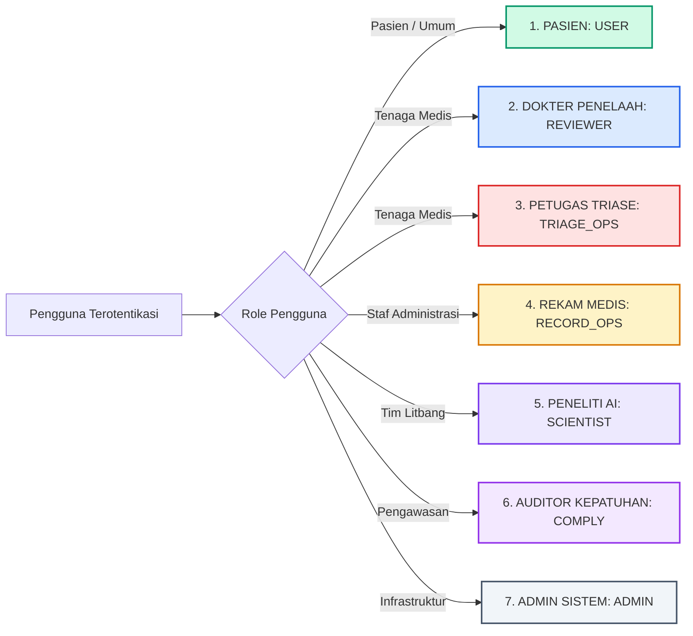

# RSUKT AI Clinical Platform — Master Engineering Documentation
## Dokumentasi Resmi Spesifikasi, UML, Arsitektur, ERD, & Kamus Data

Selamat datang di repositori dokumentasi rekayasa perangkat lunak sistem **RSUKT (Rumah Sakit Umum Khusus Terpadu) AI Clinical Consultation & Research Intelligence Platform**.

Dokumen ini disusun secara modular dan komprehensif untuk memenuhi standar industri rekayasa perangkat lunak medis (*software engineering for healthcare*), kepatuhan terhadap **UU Perlindungan Data Pribadi (UU PDP No. 27 Tahun 2022)**, **ISO/IEC 27001:2022 (Information Security Management System)**, serta standar integrasi rekam medis elektronik **Permenkes No. 24 Tahun 2022**.

---

## 📚 Struktur Berkas Dokumentasi

Seluruh dokumen rekayasa sistem disimpan secara terstruktur di dalam sub-direktori `docs/readme/`:

| Modul Dokumen | Berkas Sumber | Cakupan & Isi Utama |
| :--- | :--- | :--- |
| **Suite Animasi** | [`interactive_system_diagrams.html`](file:///c:/Users/user/RAG-model-record/docs/readme/interactive_system_diagrams.html) | **Live Animated Diagrams Viewer**: Seluruh diagram (Activity, Use Case, Sequence, Class, ERD, DFD) dengan animasi garis alur real-time, pulsing decision node, kontrol play/pause, dan zoom. |
| **Modul 01** | [`01_SRS_BUSINESS_REQUIREMENTS.md`](file:///c:/Users/user/RAG-model-record/docs/readme/01_SRS_BUSINESS_REQUIREMENTS.md) | **Software Requirements Specification (SRS)**, Proses Model Dual-Track Agile + CRISP-DM, Lingkup Bisnis B2G (SatuSehat) & B2B (Rumah Sakit/Klinik/Lab/Asuransi), Definisi 7 Aktor & Matriks RBAC, Kebutuhan Fungsional (FR), Kebutuhan Non-Fungsional (NFR), dan 10 Aturan Bisnis (BR-01 s/d BR-10). |
| **Modul 02** | [`02_UML_DAN_DIAGRAM_ARSITEKTUR.md`](file:///c:/Users/user/RAG-model-record/docs/readme/02_UML_DAN_DIAGRAM_ARSITEKTUR.md) | **Visual UML & Arsitektur Sistem**: Class Diagram (UML), Use Case Diagram 7 Aktor, Activity Diagram Alur Konsultasi & Triase Darurat IGD, Sequence Diagram Real-Time Chat & RLHF, Data Flow Diagram (DFD Level 0 Context & Level 1 Dekomposisi Fungsional). |
| **Modul 03** | [`03_ERD_DAN_KAMUS_DATA.md`](file:///c:/Users/user/RAG-model-record/docs/readme/03_ERD_DAN_KAMUS_DATA.md) | **Entity-Relationship Diagram (ERD) & Kamus Data**: Visual ERD Crow's Foot bersegmen rapi (bebas tabrakan garis), Kamus Arsitektur Data untuk seluruh 14 tabel database, aturan integritas referensial lintas RDBMS (MySQL 8.0, SQLite 3.35+, PostgreSQL Neon), dan strategi composite indexing B-Tree. |

---

## 🏛️ Ringkasan Arsitektur Teknologi

```
+-----------------------------------------------------------------------------------+
|                           PRESENTATION LAYER (FRONTEND)                           |
|  - Next.js 14 App Router, TypeScript, Tailwind CSS, Lucide Icons                  |
|  - Patient Workspace: Tampilan bersih edukatif, Tanpa Jargon ML/Simbol (*, ##)    |
|  - Admin & Researcher Workspace: Real-Time Tokenizer, Evaluasi Model, Log Audit   |
+------------------------------------------+----------------------------------------+
                                           | HTTPS / REST API / WSS
+------------------------------------------v----------------------------------------+
|                          APPLICATION LAYER (FASTAPI BACKEND)                      |
|  - FastAPI (Python 3.11+), Pydantic v2, Uvicorn ASGI                              |
|  - Keamanan: OWASP Top 10 Sanitizer, Rate-Limiting Quota (7 respons/pasien/hari)  |
|  - Isolasi Akses: Admin DILARANG mengakses sesi privat pasien secara langsung     |
+------------------------------------------+----------------------------------------+
                                           |
       +-----------------------------------+-----------------------------------+
       |                                                                       |
+------v------------------------------------+        +-------------------------v----+
|        AI, NLP & RAG ENGINE               |        |       DATA PERSISTENCE LAYER |
|  - TinyLoRA (13 Parameter RL Adaptation)  |        |  - Dual Compatible Database: |
|  - Gaussian Process Gate (LCB = u - 2.5s) |        |    * MySQL 8.0 (InnoDB)      |
|  - Cross-Encoder Re-ranker & Hybrid BM25  |        |    * SQLite 3.35+ (WAL Mode) |
|  - 384-Dimensi Vektor Embedding           |        |    * Neon Serverless Postgres|
+-------------------------------------------+        +------------------------------+
```

---

## 👥 Matriks 7 Aktor Sistem & Batasan Akses

Sistem mendefinisikan 7 peran pengguna dengan prinsip *Least Privilege* dan *Separation of Duties*:



1. **Pasien / Masyarakat (USER):** Mengakses dialog konsultasi edukatif kesehatan, riwayat percakapan sendiri, dan memberikan rating/feedback klinis. *Catatan Keamanan: Tidak dapat melihat skor reward, prompt sistem, token BPE, atau detail teknis AI.*
2. **Dokter Penelaah Medis (REVIEWER):** Memvalidasi rekomendasi klinis model, memberikan anotasi akurasi diagnosis, dan menyetujui pedoman klinis baru.
3. **Petugas Triase IGD (TRIAGE_OPS):** Menerima notifikasi darurat (*red-flag dispatch*) saat sistem mendeteksi kegawatdaruratan (nyeri dada akut, stroke suspek, henti nafas).
4. **Petugas Rekam Medis (RECORD_OPS):** Mengelola sinkronisasi data profil pasien terenkripsi ke standar format interoperabilitas HL7 / FHIR Kemenkes SatuSehat.
5. **Peneliti & Perekayasa AI (SCIENTIST):** Mengelola model registry, melatih bobot model via TinyLoRA, menginspeksi kurva pelatihan, dan melakukan evaluasi GRPO / PPO.
6. **Auditor Kepatuhan & DPO (COMPLY):** Memeriksa rekam jejak kepatuhan data pribadi (*audit trail*), memastikan pemenuhan ISO 27001 dan UU PDP No. 27/2022.
7. **Administrator Sistem IT (ADMIN):** Mengelola infrastruktur, database, cadangan data, dan konfigurasi server. **DILARANG secara keras membuka/membaca isi percakapan privat pasien tanpa persetujuan tertulis (*explicit informed consent*)**.

---

## 🔒 Jaminan Kepatuhan Regulasi & Keamanan

1. **Undang-Undang Perlindungan Data Pribadi (UU PDP No. 27/2022):**
   - NIK diproses menggunakan satu arah HMAC-SHA256 (*pseudonymization*).
   - Seluruh payload sesi chat pasien yang masuk ke periset atau evaluator klinis telah melalui tahap de-identifikasi otomatis (menghapus nama, nomor kontak, alamat, dan nomor rekam medis).
2. **ISO/IEC 27001:2022 (ISMS):**
   - Log audit abadi (*tamper-proof audit logs*) dengan relasi `ON DELETE SET NULL` pada entitas aktor.
   - Enkripsi data saat diam (*data at rest*) menggunakan algoritma AES-256-GCM dan saat transit (*data in transit*) menggunakan TLS 1.3.
3. **Standar Kemenkes SatuSehat & Permenkes No. 24/2022:**
   - Pencatatan kode ICD-10 untuk diagnosis rujukan departemen (misal `R07.9` untuk nyeri dada kardiologi).
   - Retensi rekam medis digital selama minimal 5 tahun dengan mekanisme *soft-delete*.

---

## 🚀 Status Implementasi & Tautan Live

- **Backend AI Engine (FastAPI & ML Core):**
  - Production Deployment: [https://ai-api-dusky-eight.vercel.app](https://ai-api-dusky-eight.vercel.app)
  - Endpoint Dokumentasi OpenAPI/Swagger: `https://ai-api-dusky-eight.vercel.app/docs`
- **Frontend Clinical Portal (Next.js 14):**
  - Production URL: [https://halo-skut.vercel.app](https://halo-skut.vercel.app)
  - Autentikasi Klinis: `https://halo-skut.vercel.app/login`
- **Repositori Kode Sumber:**
  - Git Branch: `main`
  - GitHub Remote: `https://github.com/not162/record-medical-development.git`

---

*Hak Cipta © 2026 RSUKT Engineering & Clinical AI Research Team. Seluruh hak cipta dilindungi undang-undang.*

