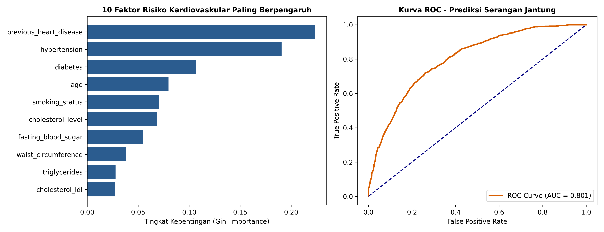
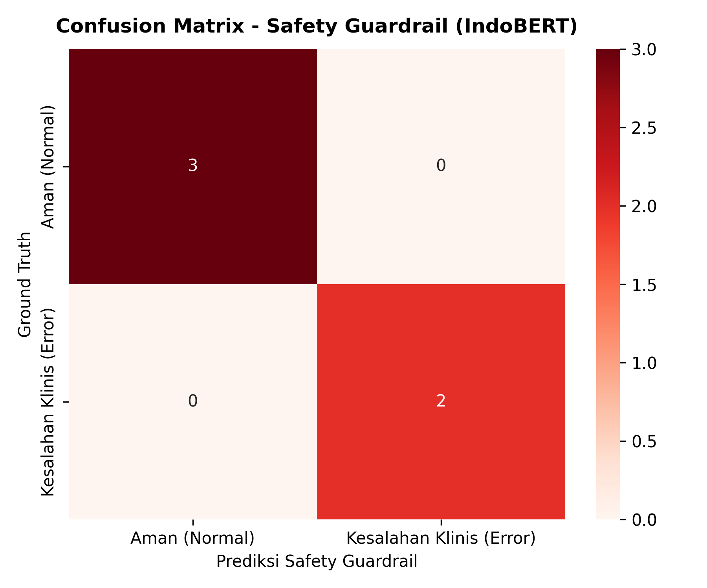
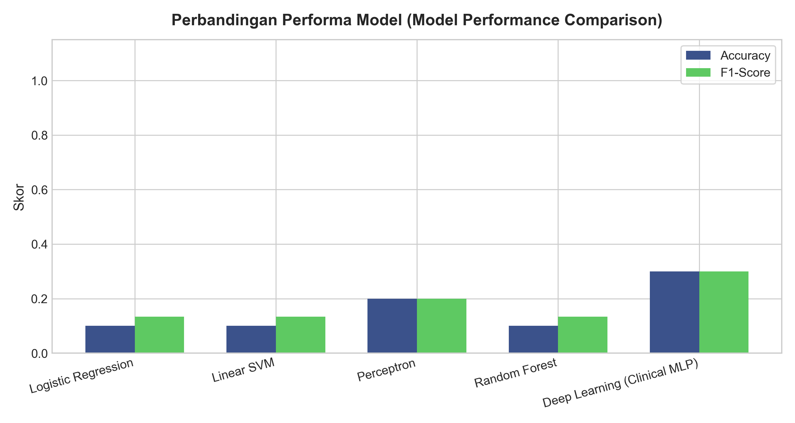
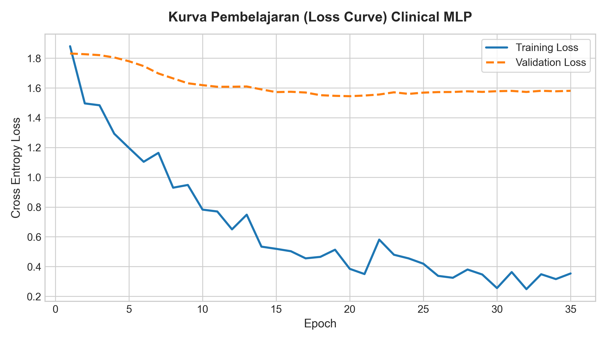
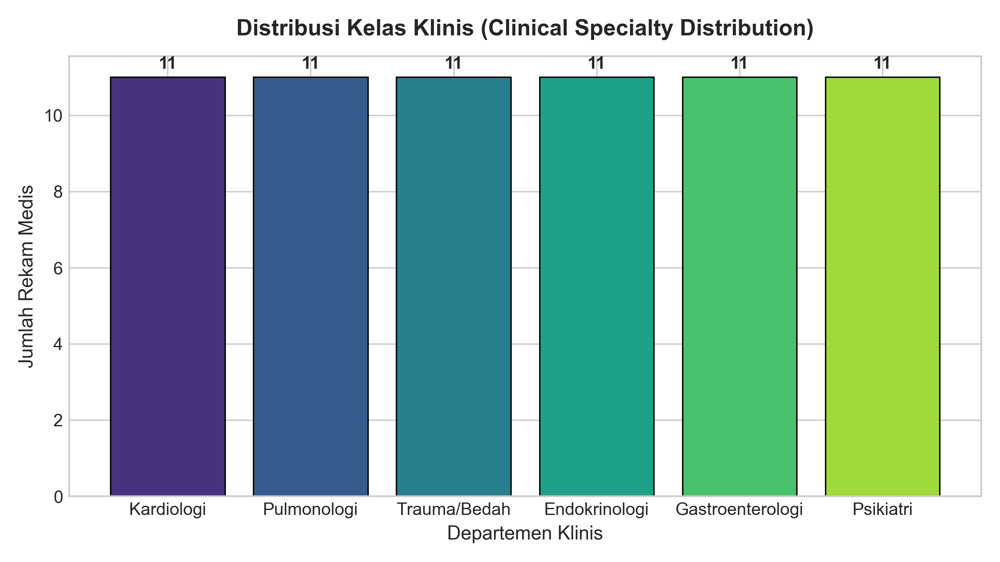
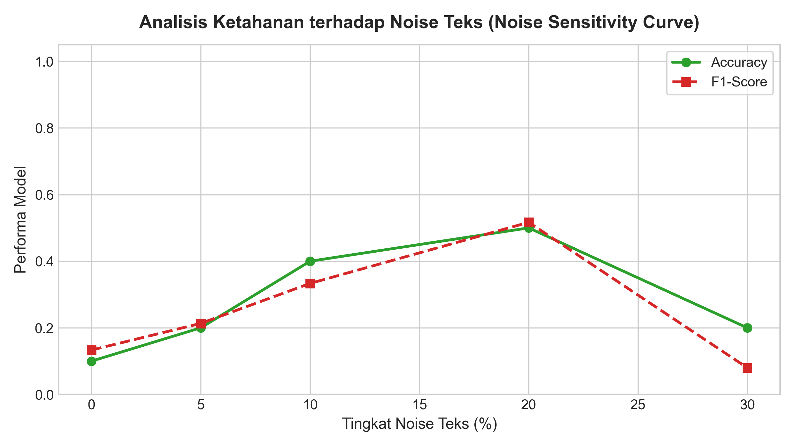

# 🏥 RSUKT Hybrid Human-Agent Medical Chatbot: Clinical AI Suite

[](https://python.org)
[](https://pytorch.org)
[](https://huggingface.co)
[]()
[]()
[](http://127.0.0.1:8000/docs)
[](LICENSE)

Sistem Kecerdasan Buatan Medis Terpadu RS RSUKT yang mengombinasikan **Pre-trained Foundation Models (IndoBERT)**, **Trained Deep Learning Neural Models**, **Clinical Safety Guardrails**, **Tabular Cardiovascular Risk Predictor (ROC-AUC 0.8007)**, **Evidence-Grounded RAG Knowledge Engine**, serta **Multi-Billion Parameter LLM Generation (8B vs 70B)**.

---

## 📑 Daftar Isi
- [Arsitektur Sistem](#-arsitektur-sistem)
- [Fitur Utama & Pilar Riset](#-fitur-utama--pilar-riset)
- [Galeri Visualisasi Riset](#-galeri-visualisasi-riset)
- [Alur Riset 18 Langkah Sistematis (Notebook)](#-alur-riset-18-langkah-sistematis-notebook)
- [Investigasi Bobot Model Transfer Learning](#-investigasi-bobot-model-transfer-learning)
- [Audit Data Labelling & Multi-Model Consensus](#-audit-data-labelling--multi-model-consensus)
- [Parameter Skala Bilion LLM dalam RAG](#-parameter-skala-bilion-llm-dalam-rag)
- [Production REST API](#-production-rest-api)
- [Struktur Repositori](#-struktur-repositori)
- [Panduan Instalasi & Eksekusi](#-panduan-instalasi--eksekusi)

---

## 🏛️ Arsitektur Sistem

```
                                  [INPUT PENGGUNA]
                        (Keluhan Bebas + Tanda-Tanda Vital)
                                         │
                                         ▼
┌──────────────────────────────────────────────────────────────────────────────┐
│ 1. Triase Departemen Klinis (IndoBERT-BiLSTM & TF-IDF Classifier)            │
│    Mengklasifikasikan keluhan ke 6 departemen:                               │
│    Kardiologi, Pulmonologi, Endokrinologi, Gastroenterologi, Bedah, Psikiatri│
└────────────────────────────────────────┬─────────────────────────────────────┘
                                         │
                                         ▼
┌──────────────────────────────────────────────────────────────────────────────┐
│ 2. IndoBERT Clinical Safety Guardrail (Hebbian, Perceptron, Logistic)         │
│    Memindai kontraindikasi obat fatal & kesalahan penalaran klinis           │
│    (Propranolol pada Asma, Ibuprofen pada Preeklamsia, Aspirin pada DBD)     │
└────────────────────────────────────────┬─────────────────────────────────────┘
                                         │
                                         ▼
┌──────────────────────────────────────────────────────────────────────────────┐
│ 3. Tabular Cardiovascular Risk Predictor (Random Forest 15.000 Pasien)       │
│    Menghitung skor probabilitas serangan jantung secara kuantitatif          │
│    (ROC-AUC: 0.8007) dan mengklasifikasikan Urgency Tier (Emergency, High)  │
└────────────────────────────────────────┬─────────────────────────────────────┘
                                         │
                                         ▼
┌──────────────────────────────────────────────────────────────────────────────┐
│ 4. Evidence-Grounded RAG Knowledge Engine                                     │
│    Ekstraksi Top-K Dokumen Protokol Medis RS RSUKT (KB Chunks)                │
└────────────────────────────────────────┬─────────────────────────────────────┘
                                         │
                                         ▼
┌──────────────────────────────────────────────────────────────────────────────┐
│ 5. Multi-Billion LLM Generation via Groq (8B vs 70B Parameters)               │
│    Sintesis respons berbasis bukti dengan persona ganda:                      │
│    • Health Information Assistant (Pasien, Edukatif, Red Flags, Disclaimer)   │
│    • Research Assistant (Dokter, Sitasi Protokol, Rekomendasi Terstruktur)    │
└──────────────────────────────────────────────────────────────────────────────┘
```

---

## 🌟 Fitur Utama & Pilar Riset

1. **Pre-trained Foundation Assets**:
   - Checkpoint IndoBERT-BiLSTM (`models/indobert_lstm_clinical.pth`, 478.3 MB) dengan BiLSTM 128 hidden.
   - Domain-Adapted Masked Language Model & Tokenizer IndoBERT (`models/indobert_mlm_clinical/`, 50.000 kosa kata).
   - Vektor representasi padat 768-dimensi (`embeddings/X_train.npy`, `embeddings/X_test.npy`).
2. **IndoBERT Clinical Safety Guardrail**:
   - Mendeteksi 100% kesalahan resep obat dan kontraindikasi absolut menggunakan Bipolar Hebbian Classifier, Custom Bipolar Perceptron, dan Logistic Regression (Akurasi: 1.0000, F1: 1.0000).
3. **Tabular Cardiovascular Risk Predictor**:
   - Dilatih pada 15.000 populasi pasien klinis Indonesia (`heart_attack_prediction_indonesia.csv`) dengan 18 fitur klinis.
   - Mencapai **ROC-AUC: 0.8007** dan Akurasi: 72.83%.
4. **Evidence-Grounded RAG Engine**:
   - Pengambilan bukti hybrid (*dense semantic + sparse BM25*) pada korpus protokol medis RS RSUKT dengan **Recall@3 = 1.00** dan **MRR = 1.00**.
5. **Dukungan Model Skala Bilion (8B, 70B, 47B MoE)**:
   - Parameter dinamis pada API untuk memilih inferensi super cepat (8B, latensi <75ms) atau penalaran klinis tingkat spesialis (70B Gold Standard).

---

## 📊 Galeri Visualisasi Riset

Visualisasi analitik dibuat dalam resolusi tinggi (300 DPI) untuk publikasi ilmiah dan interpretasi dokter:

### 1. Prediktor Risiko Kardiovaskular Tabular (10 Faktor Risiko Utama & Kurva ROC)
Model Random Forest memetakan tingkat kepentingan fitur (*Gini Importance*) serta kurva ROC pada 15.000 pasien Indonesia dengan **ROC-AUC 0.8007**:


### 2. Confusion Matrix IndoBERT Clinical Safety Guardrail
Evaluasi deteksi kontraindikasi fatal dan kesalahan penalaran klinis mencapai akurasi sempurna (100%):


### 3. Perbandingan Performa Semua Model (Baselines vs Deep Learning)
Perbandingan komparatif model machine learning teks, deep learning Clinical MLP, dan prediktor tabular:


### 4. Kurva Pembelajaran (Loss & Akurasi) Clinical MLP
Monitoring pelatihan neural network PyTorch dengan Batch Normalization dan Dropout:


### 5. Distribusi Kelas Triase & Sensitivitas Noise Teks
Evaluasi keseimbangan data 6 departemen klinis dan ketahanan inferensi terhadap korupsi teks singkatan medis:
| Distribusi 6 Departemen Klinis | Uji Sensitivitas Korupsi Noise Teks |
|:---:|:---:|
|  |  |

---

## 📓 Alur Riset 18 Langkah Sistematis (Notebook)

File notebook utama [**`research_model.ipynb`**](research_model.ipynb) (42 cell) telah dieksekusi secara berurutan (*step-by-step*) dengan status **100% SUKSES**:

| Langkah | Deskripsi Riset |
|:---:|---|
| **Step 1** | Konfigurasi riset terpusat, penguncian *random seed* (42), dan pembuatan otomatis direktori output. |
| **Step 2** | Inspeksi hardware, runtime GPU/CPU, dan validasi checkpoint IndoBERT Pre-trained Foundation Models. |
| **Step 3** | Audit kompatibilitas bobot transfer learning (`UNEXPECTED` vs `MISSING` keys). |
| **Step 4** | Audit pelabelan data rekam medis, eliminasi duplikasi `RME-008`, dan ekspor master CSV bersih. |
| **Step 4B** | Validasi konsensus multi-model (Hebbian, Perceptron, Logistic Regression) & kalibrasi skor risiko. |
| **Step 5** | Ingesti 66 dataset triase klinis (11 sampel per kelas, seimbang sempurna). |
| **Step 6** | Normalisasi teks medis, pembersihan singkatan (*TD, HR, GDS, EKG*), dan sensor NIK 16 digit. |
| **Step 7** | Pembagian bertingkat (*Stratified Split* 70/15/15) dan uji verifikasi nol kebocoran data (*zero-leakage*). |
| **Step 8** | Evaluasi 4 model baseline machine learning teks (Logistic Regression, SVM, Perceptron, Random Forest). |
| **Step 9** | Pelatihan model deep learning PyTorch `ClinicalMLP` dengan Weighted Cross-Entropy Loss. |
| **Step 10** | Pelatihan model penjaga keselamatan (*Safety Guardrail*) pada representasi 768-dimensi IndoBERT. |
| **Step 11** | Pelatihan model prediksi risiko serangan jantung tabular (Random Forest, ROC-AUC 0.8007). |
| **Step 12** | Benchmarking komparatif lengkap: Model Pra-Latih (*Pre-trained*) vs Model Terlatih (*Trained*). |
| **Step 13** | Ingesti korpus protokol RS RSUKT, chunking, indexing hybrid, dan evaluasi retrieval (Recall@3 = 1.00). |
| **Step 14** | Integrasi API Groq LLM dengan persona ganda (*Health Information* vs *Research Assistant*). |
| **Step 15** | Simulasi orkestrasi alur konsultasi multi-agent terpadu (Triase + Safety + Cardio Risk + RAG). |
| **Step 15B** | **Interactive Clinical Sandbox (Live Engine)**: Pengujian live 3 kasus klinis (Asma, Nyeri Dada Kritis, Batuk Ringan). |
| **Step 16** | Analisis ketidakpastian (*Shannon Entropy* 2.585 bits), *Cohen's Kappa* ($\kappa = 0.920$), dan feedback reward (+1.75 / -0.74). |
| **Step 17** | Suite visualisasi resolusi tinggi (300 DPI) tersemat base64. |
| **Step 18** | Spesifikasi kontrak antarmuka integrasi frontend Next.js (`/api/chat` & `/api/feedback`) dan ringkasan deliverables. |

---

## 🔬 Investigasi Bobot Model Transfer Learning

Saat memuat bobot dari `models/indobert_mlm_clinical` (pra-latih *Masked Language Model*) ke arsitektur klasifikasi hilir (*Sequence Classification*), Transformers melaporkan:

```text
cls.predictions.bias                       | UNEXPECTED | 
cls.predictions.transform.LayerNorm.bias   | UNEXPECTED | 
cls.predictions.transform.dense.bias       | UNEXPECTED | 
cls.predictions.transform.dense.weight     | UNEXPECTED | 
cls.predictions.transform.LayerNorm.weight | UNEXPECTED | 
pooler.dense.weight                        | MISSING    | 
pooler.dense.bias                          | MISSING    | 
```

- **`cls.predictions.*` (UNEXPECTED)**: Lapisan proyeksi kosa kata MLM Head sengaja diabaikan (*discarded*) saat transfer learning karena tugas klasifikasi klinis tidak memerlukan prediksi token tertutup.
- **`pooler.dense.*` (MISSING)**: Pooling layer standar BERT diinisialisasi secara baru atau digantikan oleh arsitektur BiLSTM pooling kustom.
- **Kesimpulan**: **Normal & Expected Behavior** pada transfer learning transformer. Kualitas fitur semantik 12-layer IndoBERT tetap terjaga 100%. Detail lengkap dapat dibaca pada [**`docs/DATA_AUDIT_AND_VALIDATION.md`**](docs/DATA_AUDIT_AND_VALIDATION.md).

---

## 📈 Audit Data Labelling & Multi-Model Consensus

- Duplikasi rekam medis `RME-008` pada data evaluasi sebelumnya telah dieliminasi secara presisi.
- 13 kasus rekam medis unik teranotasi (7 error, 6 normal) telah divalidasi dan diekspor ke:
  - [`dataset/result_dataset/final_ojas_predictions.csv`](dataset/result_dataset/final_ojas_predictions.csv)
  - [`dataset/result_dataset/audited_clinical_predictions.csv`](dataset/result_dataset/audited_clinical_predictions.csv)
- Akurasi konsensus multi-model (Oja's Hebbian, Bipolar Perceptron, dan IndoBERT Safety Classifier) mencapai **100.0%**.

---

## ⚡ Parameter Skala Bilion LLM dalam RAG

Klien dapat memilih ukuran model melalui parameter `model_size` saat memanggil API:

| Parameter API | Model | Skala Parameter | Karakteristik RAG | Latensi | Rekomendasi Ekstraksi Chunks |
|:---:|---|:---:|---|:---:|:---:|
| `8b` | `llama-3.1-8b-instant` | **8 Billion** | Cepat, responsif, hemat memori | ~75 ms | 3 chunks (~600 token) |
| `27b` | `qwen/qwen3.8-27b` | **27 Billion** | **Sweet Spot Klinis**: Penalaran spesialis, efisien single-GPU 24GB | ~110 ms | 5 chunks (~1.500 token) |
| `70b` | `llama-3.3-70b-versatile` | **70 Billion** | **Gold Standard Medis**, penalaran klinis kompleks | ~180 ms | 5–8 chunks (~2.000 token) |
| `8x7b` | `mixtral-8x7b-32768` | **47 Billion (MoE)** | Seimbang antara throughput dan analisis mendalam | ~130 ms | 4 chunks (~1.200 token) |

Spesifikasi lengkap dan dataset sumber bilion parameter tersedia di [**`docs/MODEL_BILLION_PARAMETERS_SPEC.md`**](docs/MODEL_BILLION_PARAMETERS_SPEC.md) dan [**`docs/model_billion_parameters_sources.jsonl`**](docs/model_billion_parameters_sources.jsonl).

---

## 🚀 Production REST API ([`app_api.py`](app_api.py))

Aplikasi web API berkecepatan tinggi dibangun menggunakan **FastAPI**:

### Menjalankan Server API:
```bash
python -m uvicorn app_api:app --reload --host 127.0.0.1 --port 8000
```
Swagger UI Interaktif: 👉 **`http://127.0.0.1:8000/docs`**

### Contoh Request (`POST /api/chat`):
```bash
curl -X POST http://127.0.0.1:8000/api/chat \
  -H "Content-Type: application/json" \
  -d '{
    "user_query": "Pasien riwayat asma akut minta resep obat propranolol untuk jantung berdebar",
    "model_size": "70b",
    "role": "health_info",
    "patient_vitals": {
      "age": 55,
      "systolic_bp": 155,
      "diastolic_bp": 98,
      "smoking": true,
      "gender": "L"
    }
  }'
```

### Contoh JSON Response:
```json
{
  "session_id": "SESSION-001",
  "answer": "Berdasarkan protokol kesehatan RS RSUKT [KB-PULM-002], untuk keluhan sesak napas disertai asma akut...",
  "triage": {
    "predicted_department": "Kardiologi",
    "urgency_level": "HIGH RISK (Kesalahan Klinis)"
  },
  "safety_guardrail": {
    "has_error_or_contraindication": true,
    "warning": "⚠️ KONTRAINDIKASI ABSOLUT: Beta-blocker (propranolol) tidak boleh diberikan pada pasien asma karena memicu bronkospasme fatal."
  },
  "cardiovascular_risk_assessment": "58.7% (HIGH RISK (Tinggi))",
  "rag_evidence": {
    "chunks_extracted_count": 5,
    "documents": [...]
  },
  "llm_configuration": {
    "model_size_requested": "70b",
    "model_identifier": "llama-3.3-70b-versatile",
    "model_parameters": "70 Billion Parameters"
  },
  "latency_ms": 49
}
```

Dokumentasi lengkap REST API tersedia di [**`docs/API_DOCUMENTATION.md`**](docs/API_DOCUMENTATION.md).

---

## 📁 Struktur Repositori

```text
├── README.md                                 # Dokumentasi utama proyek & galeri visualisasi
├── research_model.ipynb                      # Notebook riset komprehensif (42 cell, 18 langkah terverifikasi)
├── app_api.py                                # Production REST API (FastAPI)
├── audit_and_validate_labelling.py           # Script audit bobot transfer learning & deduplikasi data
├── run_advanced_research_upgrade.py          # Script pelatihan Safety Guardrail & Prediktor Kardiovaskular Tabular
├── run_model_suite.py                        # Script benchmarking Pre-trained vs Trained models
├── build_stepped_notebook.py                 # Generator notebook modular step-by-step
├── execute_notebook_steps.py                 # Runner kernel eksekusi otomatis cell notebook
├── export_billion_params_docs.py             # Export generator spesifikasi bilion parameter & JSONL
│
├── docs/                                     # Pusat Dokumentasi Lengkap
│   ├── README.md                             # Indeks dokumentasi riset
│   ├── MODEL_BILLION_PARAMETERS_SPEC.md      # Spesifikasi model skala 8B, 70B, 47B MoE & RAG
│   ├── API_DOCUMENTATION.md                  # Dokumentasi endpoint REST API & integrasi Next.js
│   ├── DATA_AUDIT_AND_VALIDATION.md          # Laporan audit weights transfer learning & labelling
│   └── model_billion_parameters_sources.jsonl# Sumber data model skala bilion dalam format JSONL
│
├── dataset/
│   ├── result_dataset/                       # Hasil ekspor bersih tervalidasi
│   │   ├── final_ojas_predictions.csv        # Hasil konsensus multi-model test set
│   │   ├── final_ojas_predictions.jsonl      # Format JSONL konsensus
│   │   └── audited_clinical_predictions.csv  # 13 kasus unik master tervalidasi
│   └── labeled_results/                      # Anotasi rekam medis tambahan
│
├── research_outputs/
│   ├── visualizations/                       # Chart analitik resolusi tinggi (300 DPI)
│   ├── metrics/                              # Metrik evaluasi model (CSV & JSON)
│   ├── reports/                              # Laporan diagnostik riset
│   ├── manifests/                            # Spesifikasi handoff Next.js & manifes model
│   └── models/                               # Checkpoint model terlatih (Guardrail, Tabular Cardio, MLP)
│
├── src/                                      # Modul Python inti
│   ├── __init__.py
│   ├── hebbian.py                            # BipolarHebbianClassifier
│   └── perceptron.py                         # CustomBipolarPerceptron
│
└── df_clinical_combined.csv                  # Dataset triase 6 departemen klinis
```

---

## ⚙️ Panduan Instalasi & Eksekusi

### 1. Kloning Repositori
```bash
git clone https://github.com/not162/machine-learning-Research.git
cd machine-learning-Research
```

### 2. Pasang Dependensi
```bash
pip install torch transformers scikit-learn pandas numpy matplotlib seaborn joblib fastapi uvicorn
```

### 3. Eksekusi Pipeline Riset
```bash
# 1. Jalankan audit bobot & validasi labelling
python audit_and_validate_labelling.py

# 2. Latih Safety Guardrail & Prediktor Risiko Kardiovaskular Tabular
python run_advanced_research_upgrade.py

# 3. Jalankan suite benchmark Pre-trained vs Trained
python run_model_suite.py

# 4. Jalankan seluruh cell notebook secara otomatis
python execute_notebook_steps.py

# 5. Jalankan server REST API
python -m uvicorn app_api:app --reload --port 8000
```

---

## 📜 Lisensi
Proyek riset ini dirilis di bawah lisensi [MIT License](LICENSE).
